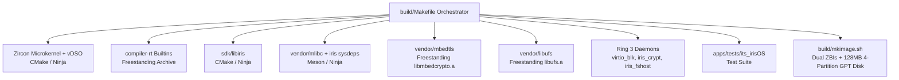

# irisOS Build System Architecture & Multi-Toolchain Guide

## 1. Overview

`irisOS` employs a heterogeneous, multi-toolchain build system orchestrated by a master Makefile in [`build/Makefile`](../build/Makefile). Because irisOS leverages proven open-source components with distinct upstream build tools (CMake, Meson, GNU Make, Ninja), the orchestrator provides a unified, cross-platform build interface on macOS Apple Silicon (`Darwin arm64`).



---

## 2. Host Environment & Toolchain Requirements

### 2.1 macOS Apple Silicon Host

* **Host Platform:** macOS (`Darwin arm64`, Apple Silicon M-series).
* **Mandatory Dependencies:**
  ```bash
  brew install llvm cmake ninja meson qemu xorriso mtools
  ```

### 2.2 Toolchain Binaries (Homebrew LLVM)

Apple's native compiler (`/usr/bin/clang`) is restricted to the Darwin Mach-O binary format and does not ship with `ld.lld` (LLVM ELF Linker). Therefore, **all compilation and linking in irisOS strictly mandate Homebrew LLVM**:

| Tool | Path | Purpose |
| :--- | :--- | :--- |
| **C Compiler** | `/opt/homebrew/opt/llvm/bin/clang` | Compiles freestanding and user-space C sources |
| **C++ Compiler** | `/opt/homebrew/opt/llvm/bin/clang++` | Compiles mlibc, frigg, and C++ servers |
| **Linker** | `/opt/homebrew/opt/llvm/bin/ld.lld` | Links freestanding ELFs, shared objects (`.so`), and static archives |
| **Archiver** | `/opt/homebrew/opt/llvm/bin/llvm-ar` | Generates static libraries (`.a`) |
| **Objcopy** | `/opt/homebrew/opt/llvm/bin/llvm-objcopy` | ELF section manipulation and symbol stripping |
| **Ranlib** | `/opt/homebrew/opt/llvm/bin/llvm-ranlib` | Indexes static archives |

---

## 3. Target Architectures & Triples

irisOS targets 64-bit architectures only with zero legacy 16-bit or 32-bit support:

### 3.1 x86_64 Target

* **Freestanding / Microkernel / SDK:**
  * Target Triple: `x86_64-unknown-elf`
  * Compiler Flags: `-ffreestanding -fno-builtin -fno-stack-protector -fPIE -mno-red-zone`
* **C Library / Dynamic Runtime (mlibc):**
  * Target Triple: `x86_64-unknown-linux-gnu` (used by Clang to select ELF/SysV ABI conventions)
  * Meson Cross File: [`build/toolchains/meson-x86_64.txt`](../build/toolchains/meson-x86_64.txt)
  * CMake Toolchain: [`build/toolchains/x86_64-iris.cmake`](../build/toolchains/x86_64-iris.cmake)

### 3.2 AArch64 Target

* **Freestanding / Microkernel / SDK:**
  * Target Triple: `aarch64-unknown-elf`
  * Compiler Flags: `-ffreestanding -fno-builtin -fno-stack-protector -fPIE`
* **C Library / Dynamic Runtime (mlibc):**
  * Target Triple: `aarch64-unknown-linux-gnu`
  * Meson Cross File: [`build/toolchains/meson-aarch64.txt`](../build/toolchains/meson-aarch64.txt)
  * CMake Toolchain: [`build/toolchains/aarch64-iris.cmake`](../build/toolchains/aarch64-iris.cmake)

---

## 4. Subsystem Build Modules

### 4.1 Zircon Microkernel (`kernel/zircon/`)
* Built via custom CMake wrapper driving the standalone Zircon build rules with Homebrew Clang.
* Generates:
  * Microkernel image (`zircon.elf` / `kernel.zbi`).
  * System call vDSO (`libzircon.so` / `libzircon.a`).
  * Host image packaging tool (`zbi`).

### 4.2 Compiler-RT Builtins (`vendor/compiler-rt/`)
* Required for low-level arithmetic (e.g. 64-bit/128-bit integer division, modulo, and soft-float functions) in freestanding code where compiler intrinsics are emitted by Clang.
* Compiled as freestanding static library `libclang_rt.builtins-<arch>.a` placed in `out/build-<arch>/lib/`.

### 4.3 Native SDK (`sdk/libiris/`)
* Built via CMake as both static (`libiris.a`) and shared (`libiris.so`) libraries.
* Provides:
  * 24-byte IPC wire protocol header ([`iris/ipc.h`](../sdk/libiris/include/iris/ipc.h)).
  * Channel message/handle transfer primitives ([`iris/channel.h`](../sdk/libiris/include/iris/channel.h)).
  * VMO allocation and mapping helpers ([`iris/vmo.h`](../sdk/libiris/include/iris/vmo.h)).
  * User-space process spawning primitives ([`iris/spawn.h`](../sdk/libiris/include/iris/spawn.h)).

### 4.4 C Library & Dynamic Linker (`vendor/mlibc` + `sdk/mlibc-sysdeps/iris/`)
* Cross-compiled using Meson and Ninja with our native irisOS sysdeps.
* Injected via symlink `vendor/mlibc/sysdeps/iris -> sdk/mlibc-sysdeps/iris`.
* Outputs:
  * `libc.a`: Static standard C library.
  * `libc.so`: Shared standard C library.
  * `ld-iris.so`: Dynamic linker/loader for irisOS.

### 4.5 Cryptographic & Filesystem Libraries (`vendor/mbedtls` & `vendor/libufs`)
* **Mbed-TLS 3.6 (`libmbedcrypto.a`)**: Built freestanding with AES-256-XTS and Argon2id for `iris_crypt`.
* **FreeBSD UFS2 (`libufs.a`)**: Built freestanding with Homebrew LLVM using `-D_LIBUFS -Dpread=iris_ufs_pread -Dpwrite=iris_ufs_pwrite` to route block I/O through `servers/iris_fshost/src/ufs_io.c`.

### 4.6 Bootable Image & GPT Disk Generation (`build/mkimage.sh`)
* Packs system binaries (`iris_init`, `virtio_blk`, `iris_crypt`, `iris_fshost`, `its_irisOS`) and vDSO (`libzircon.so`) into dual bootable ZBIs (`iris_a.zbi` and `iris_b.zbi`).
* Generates a 64 MB FAT32 UEFI ESP disk image (`esp_<arch>.img`) containing:
  * `/EFI/BOOT/BOOTX64.EFI` (or `BOOTAA64.EFI`) — Gigaboot UEFI bootloader stub.
  * `/EFI/BOOT/iris_a.zbi` and `iris_b.zbi` — Bootfs images for slots A and B.
* Generates a 128 MB 4-partition GPT disk image (`disk_<arch>.raw` / `disk.img`):
  * Partition 1: `ESP` (32 MB FAT).
  * Partition 2: `System_A` (32 MB UFS2, active immutable system root).
  * Partition 3: `System_B` (32 MB UFS2, inactive rollback slot).
  * Partition 4: `Data` (30 MB Encrypted UFS2 via `iris_crypt`).

---

## 5. Execution Modes & Dynamic Linking Architecture

### 5.1 Early Bootstrap (`iris_init`)
`iris_init` is invoked directly by Zircon's `userboot`. It does not use standard C runtime startup or a dynamic linker. It parses the mapped vDSO symbol table dynamically to bind system calls and extract bootstrap capability handles from `zx_proc_args_t`.

### 5.2 Ring 3 Storage Stack & VFS Initialization (Phase 4 Status)
During bootstrap, `iris_init`:
1. Scans PCIe via ECAM to discover `virtio-blk-pci` and launches `bin/virtio_blk`.
2. Launches `bin/iris_crypt`, which validates the 4 KB Sector 0 metadata header on Partition 4 (`Data`) and unlocks the master key via Argon2id.
3. Launches `bin/iris_fshost`, which parses the GPT layout, mounts `System_A` at `/System` (RO) via `libufs`, mounts decrypted `Data` at `/Users` and `/Applications` (RW) via `iris_crypt`, and creates in-memory virtual symlinks `/bin -> /System/Bin` and `/lib -> /System/Libraries`.
4. Launches `apps/tests/its_irisOS` with inherited VFS router channel `PA_HND(PA_NS_DIR, 0)`.

### 5.3 Dynamic Linking (`ld-iris.so` + `libc.so`)
Both `ld-iris.so` and `libc.so` are fully compiled and verified in the build tree:
* `ld-iris.so` functions as a freestanding dynamic linker capable of mapping ELF segments from VMOs and resolving symbols.
* In Phase 5, `iris_spawn` will pass the dynamic linker VMO from `/System/Libraries/ld-iris.so` to dynamically execute binaries across `/System/Bin`.

---

## 6. Build Targets & Execution Commands

irisOS provides a unified CLI and Makefile interface at the repository root supporting 3 target categories: all architectures (`all`), x86_64 (`x86_64`), and AArch64 (`aarch64`).

### 6.1 System Build Commands

| Command | Description |
| :--- | :--- |
| `make build all` (or `./iris build all`) | Compiles microkernel, libc, SDK, drivers, and packages ESP and GPT disk images for **both** x86_64 and aarch64 |
| `make build x86_64` (or `./iris build x86_64`) | Builds system and packages images (`esp_x86_64.img`, `disk_x86_64.raw`) for **x86_64** |
| `make build aarch64` (or `./iris build aarch64`) | Builds system and packages images (`esp_aarch64.img`, `disk_aarch64.raw`) for **aarch64** |

### 6.2 Virtual Machine Run Commands

When running the virtual machine, irisOS defaults to launching in a **QEMU Cocoa graphical window alongside standard serial console output in stdio** (for simultaneous debugging if graphics are initializing). VM runs use the existing disk images without rebuilding.

| Command | Description |
| :--- | :--- |
| `make run all` (or `./iris run all`) | Displays a confirmation warning and boots **both** x86_64 and aarch64 VMs concurrently with multiplexed serial logging |
| `make run x86_64` (or `./iris run x86_64`) | Boots the x86_64 VM in a QEMU window with serial console connected to stdio |
| `make run aarch64` (or `./iris run aarch64`) | Boots the aarch64 VM in a QEMU window with serial console connected to stdio |

### 6.3 Automated Headless Verification (Test Commands)

Automated headless test runner ([`scripts/verify_qemu.py`](../scripts/verify_qemu.py)) launches QEMU with non-blocking I/O and strict 20s timeouts to verify PCIe block driver, AES-256-XTS proxy, GPT parsing, UFS2 VFS mounting, and persistent file I/O:

| Command | Description |
| :--- | :--- |
| `make test all` (or `./iris test all`) | Runs automated headless tests on **both** x86_64 and aarch64 sequentially |
| `make test x86_64` (or `./iris test x86_64`) | Runs automated headless test on **x86_64** |
| `make test aarch64` (or `./iris test aarch64`) | Runs automated headless test on **aarch64** |

### 6.4 Low-Level Subsystem Targets (`build/Makefile`)

For granular rebuilds of individual components, the orchestrator in [`build/Makefile`](../build/Makefile) provides:

| Target Command | Description |
| :--- | :--- |
| `make -C build mlibc-x86_64` | Rebuilds only mlibc (`libc.a`, `libc.so`, `ld-iris.so`) for x86_64 |
| `make -C build mlibc-aarch64` | Rebuilds only mlibc for aarch64 |
| `make -C build virtio-blk-x86_64` | Rebuilds only the Ring 3 PCIe VirtIO block driver daemon for x86_64 |
| `make -C build iris-crypt-x86_64` | Rebuilds only the block-level encryption proxy daemon for x86_64 |
| `make -C build iris-fshost-x86_64` | Rebuilds only the central VFS router daemon for x86_64 |
| `make -C build clean` | Cleans build outputs and compiled images |
