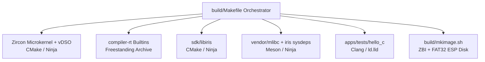

# irisOS Build System Architecture & Multi-Toolchain Guide

## 1. Overview

`irisOS` employs a heterogeneous, multi-toolchain build system orchestrated by a master Makefile in [`build/Makefile`](../build/Makefile). Because irisOS leverages proven open-source components with distinct upstream build tools (CMake, Meson, GNU Make, Ninja), the orchestrator provides a unified, cross-platform build interface on macOS Apple Silicon (`Darwin arm64`).



---

## 2. Host Environment & Toolchain Requirements

### 2.1 macOS Apple Silicon Host

* **Host Platform:** macOS (`Darwin arm64`, Apple Silicon M-series).
* **Mandatory Dependencies:**
  ```bash
  brew install llvm cmake ninja meson qemu xorriso mtools
  ```

### 2.2 Toolchain Binaries (Homebrew LLVM)

Apple's native compiler (`/usr/bin/clang`) is restricted to the Darwin Mach-O binary format and does not ship with `ld.lld` (LLVM ELF Linker). Therefore, **all compilation and linking in irisOS strictly mandate Homebrew LLVM**:

| Tool | Path | Purpose |
| :--- | :--- | :--- |
| **C Compiler** | `/opt/homebrew/opt/llvm/bin/clang` | Compiles freestanding and user-space C sources |
| **C++ Compiler** | `/opt/homebrew/opt/llvm/bin/clang++` | Compiles mlibc, frigg, and C++ servers |
| **Linker** | `/opt/homebrew/opt/llvm/bin/ld.lld` | Links freestanding ELFs, shared objects (`.so`), and static archives |
| **Archiver** | `/opt/homebrew/opt/llvm/bin/llvm-ar` | Generates static libraries (`.a`) |
| **Objcopy** | `/opt/homebrew/opt/llvm/bin/llvm-objcopy` | ELF section manipulation and symbol stripping |
| **Ranlib** | `/opt/homebrew/opt/llvm/bin/llvm-ranlib` | Indexes static archives |

---

## 3. Target Architectures & Triples

irisOS targets 64-bit architectures only with zero legacy 16-bit or 32-bit support:

### 3.1 x86_64 Target

* **Freestanding / Microkernel / SDK:**
  * Target Triple: `x86_64-unknown-elf`
  * Compiler Flags: `-ffreestanding -fno-builtin -fno-stack-protector -fPIE -mno-red-zone`
* **C Library / Dynamic Runtime (mlibc):**
  * Target Triple: `x86_64-unknown-linux-gnu` (used by Clang to select ELF/SysV ABI conventions)
  * Meson Cross File: [`build/toolchains/meson-x86_64.txt`](../build/toolchains/meson-x86_64.txt)
  * CMake Toolchain: [`build/toolchains/x86_64-iris.cmake`](../build/toolchains/x86_64-iris.cmake)

### 3.2 ARM64 (AArch64) Target

* **Freestanding / Microkernel / SDK:**
  * Target Triple: `aarch64-unknown-elf`
  * Compiler Flags: `-ffreestanding -fno-builtin -fno-stack-protector -fPIE`
* **C Library / Dynamic Runtime (mlibc):**
  * Target Triple: `aarch64-unknown-linux-gnu`
  * Meson Cross File: [`build/toolchains/meson-arm64.txt`](../build/toolchains/meson-arm64.txt)
  * CMake Toolchain: [`build/toolchains/arm64-iris.cmake`](../build/toolchains/arm64-iris.cmake)

---

## 4. Subsystem Build Modules

### 4.1 Zircon Microkernel (`kernel/zircon/`)
* Built via custom CMake wrapper driving the standalone Zircon build rules with Homebrew Clang.
* Generates:
  * Microkernel image (`zircon.elf` / `kernel.zbi`).
  * System call vDSO (`libzircon.so` / `libzircon.a`).
  * Host image packaging tool (`zbi`).

### 4.2 Compiler-RT Builtins (`vendor/compiler-rt/`)
* Required for low-level arithmetic (e.g. 64-bit/128-bit integer division, modulo, and soft-float functions) in freestanding code where compiler intrinsics are emitted by Clang.
* Compiled as freestanding static library `libclang_rt.builtins-<arch>.a` placed in `out/build-<arch>/lib/`.

### 4.3 Native SDK (`sdk/libiris/`)
* Built via CMake as both static (`libiris.a`) and shared (`libiris.so`) libraries.
* Provides:
  * 24-byte IPC wire protocol header ([`iris/ipc.h`](file:///Users/stefan/Dev/irisos/sdk/libiris/include/iris/ipc.h)).
  * Channel message/handle transfer primitives ([`iris/channel.h`](file:///Users/stefan/Dev/irisos/sdk/libiris/include/iris/channel.h)).
  * VMO allocation and mapping helpers ([`iris/vmo.h`](file:///Users/stefan/Dev/irisos/sdk/libiris/include/iris/vmo.h)).
  * User-space process spawning primitives ([`iris/spawn.h`](file:///Users/stefan/Dev/irisos/sdk/libiris/include/iris/spawn.h)).

### 4.4 C Library & Dynamic Linker (`vendor/mlibc` + `sdk/mlibc-sysdeps/iris/`)
* Cross-compiled using Meson and Ninja with our native irisOS sysdeps.
* Injected via symlink `vendor/mlibc/sysdeps/iris -> sdk/mlibc-sysdeps/iris`.
* Outputs:
  * `libc.a`: Static standard C library.
  * `libc.so`: Shared standard C library.
  * `ld-iris.so`: Dynamic linker/loader for irisOS.

### 4.5 Bootable Image Generation (`build/mkimage.sh`)
* Packs userboot binaries (`iris_init`, `bin/hello_c`) and vDSO (`libzircon.so`) into `iris_a.zbi`.
* Generates a 64MB FAT32 UEFI ESP disk image (`esp_<arch>.img`) containing:
  * `/EFI/BOOT/BOOTX64.EFI` (or `BOOTAA64.EFI`) — Gigaboot UEFI bootloader stub.
  * `/EFI/BOOT/iris_a.zbi` — Bootfs containing early system servers.

---

## 5. Execution Modes & Dynamic Linking Architecture

### 5.1 Early Bootstrap (`iris_init`)
`iris_init` is invoked directly by Zircon's `userboot`. It does not use standard C runtime startup or a dynamic linker. It parses the mapped vDSO symbol table dynamically to bind system calls and extract bootstrap capability handles from `zx_proc_args_t`.

### 5.2 Static-PIE User Space (Phase 3 Status)
In Phase 3, user-space applications (such as `apps/tests/hello_c`) are compiled as Position-Independent Executables (PIE) linked against static `libc.a`, `libiris.a`, and `crt1.o`. During startup:
1. `entry.cpp` performs self-relocation against its own `DT_RELA` table.
2. Extracts inherited file descriptors (`PA_HND(PA_FD, fd)`) and debuglog handles from `zx_proc_args_t`.
3. Sets up thread-local storage (TLS) and the thread control block (TCB).
4. Calls `main(argc, argv, environ)`.

### 5.3 Dynamic Linking (`ld-iris.so` + `libc.so`)
Both `ld-iris.so` and `libc.so` are fully compiled and verified in the build tree:
* `ld-iris.so` functions as a freestanding dynamic linker capable of mapping ELF segments from VMOs and resolving symbols.
* **Phase 4 Integration:** When `iris_fshost` mounts `/System/Libraries` from the active UFS2 partition (`System_A`), `iris_spawn` will pass the dynamic linker VMO, enabling dynamic binaries across `/System/Bin`.

---

## 6. Build Targets & Verification

| Target Command | Description |
| :--- | :--- |
| `make -C build all` | Builds complete kernel, SDK, mlibc, user binaries, and disk images for x86_64 |
| `make -C build all-arm64` | Builds complete system and disk images for ARM64 |
| `make -C build mlibc-x86_64` | Rebuilds only mlibc (libc.a, libc.so, ld-iris.so) for x86_64 |
| `make -C build mlibc-arm64` | Rebuilds only mlibc for ARM64 |
| `make -C build image-x86_64` | Packages ZBI and FAT32 ESP disk image for x86_64 |
| `make -C build image-arm64` | Packages ZBI and FAT32 ESP disk image for ARM64 |
| `make -C build run` | Boots x86_64 QEMU with UEFI (q35) |
| `make -C build run-arm` | Boots ARM64 QEMU with UEFI (virt) |
