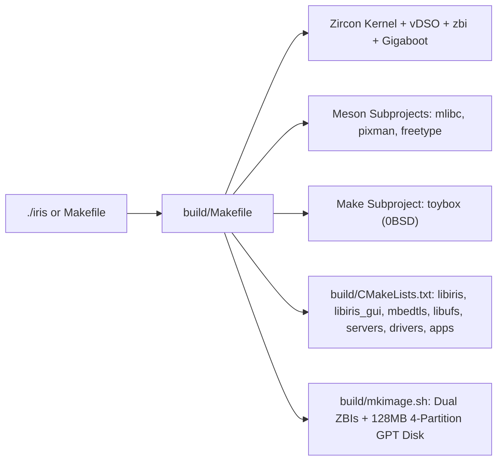

# irisOS Build System & Multi-Toolchain Guide

## 1. Architecture Overview
`irisOS` uses a multi-toolchain build orchestrator in [`build/Makefile`](../build/Makefile) and [`build/CMakeLists.txt`](../build/CMakeLists.txt) that coordinates CMake, Meson, and GNU Make subprojects on macOS Apple Silicon (`Darwin arm64`).

---

## 2. Homebrew LLVM Cross-Toolchain
Apple's `/usr/bin/clang` targets Mach-O only and lacks `ld.lld`. All toolchain files in [`build/toolchains/`](../build/toolchains/) strictly mandate Homebrew LLVM:

| Binary | Path | Role |
| :--- | :--- | :--- |
| **Compilers** | `/opt/homebrew/opt/llvm/bin/{clang,clang++}` | Freestanding & userland C/C++ compilation |
| **Linker** | `/opt/homebrew/opt/llvm/bin/ld.lld` | ELF static, PIE, and shared object (`.so`) linking |
| **Archiver / Utils** | `/opt/homebrew/opt/llvm/bin/llvm-{ar,ranlib,objcopy}` | Archive indexing and ELF binary packaging |

### Target Triples & Toolchain Configs
* **`x86_64`:** `x86_64-unknown-elf` (freestanding / kernel / SDK) and `x86_64-unknown-linux-gnu` (SysV ELF ABI for `mlibc`), configured via [`x86_64-iris.cmake`](../build/toolchains/x86_64-iris.cmake) and [`meson-x86_64.txt`](../build/toolchains/meson-x86_64.txt).
* **`aarch64`:** `aarch64-unknown-elf` and `aarch64-unknown-linux-gnu`, configured via [`aarch64-iris.cmake`](../build/toolchains/aarch64-iris.cmake) and [`meson-aarch64.txt`](../build/toolchains/meson-aarch64.txt).

---

## 3. Subsystem Build Targets

| Component | Build System | Output Artifacts |
| :--- | :--- | :--- |
| **Zircon & Gigaboot** (`kernel/zircon/`) | CMake / Make | `zircon.elf`, `libzircon.{a,so}`, host `zbi`, `BOOTX64.EFI` / `BOOTAA64.EFI` |
| **Compiler Builtins** (`vendor/compiler-rt/`) | CMake | `libclang_rt.builtins-<arch>.a` |
| **Native SDK** (`sdk/libiris/`, `sdk/libiris_gui/`) | CMake | `libiris.{a,so}`, `libiris_gui.{a,so}` |
| **C Runtime & Loader** (`vendor/mlibc/`) | Meson / Ninja | `libc.a`, `libc.so`, `ld-iris.so`, `crt1.o`, `crti.o`, `crtn.o` |
| **Graphics Libraries** (`vendor/pixman/`, `vendor/freetype/`) | Meson / CMake | `libpixman-1.{a,so}`, `libfreetype.{a,so}` (FTL) |
| **Crypto & UFS2** (`vendor/mbedtls/`, `vendor/libufs/`) | CMake | `libmbedcrypto.a`, `libufs.a`, host `mkufs2` formatter |
| **CLI Shell** (`vendor/toybox/`) | Make / Kconfig | `/System/Bin/toybox` + 200+ POSIX symlinks (`sh`, `ls`, `cat`, etc.) |
| **Ring 3 Servers & Drivers** (`servers/`) | CMake | `iris_init`, `virtio_blk`, `virtio_gpu`, `gop_fb`, `iris_crypt`, `iris_fshost`, `iris_pty`, `iris_compositor` |
| **System Apps & Tests** (`apps/`) | CMake | `passphrase`, `abctl`, `sys_overlay`, `its_irisOS` |

---

## 4. Image Packaging (`build/mkimage.sh`) & Commands

`build/mkimage.sh` packs early boot binaries into `/EFI/BOOT/iris_a.zbi` and `iris_b.zbi` on `esp_<arch>.img` (64 MB FAT32) and formats the 128 MB 4-partition GPT disk (`disk_<arch>.raw`):
1. **Partition 1 (`ESP`):** 32 MB FAT32.
2. **Partition 2 (`System_A`):** 32 MB Read-Only UFS2 (`/System/{Bin,Libraries,Servers,Resources}`).
3. **Partition 3 (`System_B`):** 32 MB Read-Only UFS2 (inactive A/B slot).
4. **Partition 4 (`Data`):** 30 MB AES-256-XTS encrypted UFS2 (`/Users`, `/Applications`).

### Common Build, Run & Test Commands
* **Build:** `./iris build <all|x86_64|aarch64>` (or `make build <target>`)
* **Run (Cocoa GUI + Serial):** `./iris run <x86_64|aarch64|all>` (supports multi-threaded TCG by default and `IRIS_QEMU_HVF=1` on Apple Silicon)
* **Automated Headless Verification:** `./iris test <all|x86_64|aarch64>` (runs [`scripts/verify_qemu.py`](../scripts/verify_qemu.py))
* **Granular Rebuilds:** `make -C build <mlibc|pixman|freetype|toybox>-<x86_64|aarch64>`
