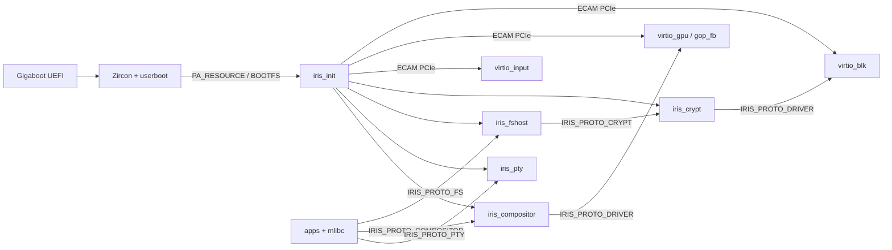

# irisOS Repository Architecture & Symbol Graph

> Auto-generated by `scripts/gen_repo_graph.py`. Query specific items via `./iris graph op|file|target <term>` before reading large files.

## 1. System & IPC Topology

## 2. Build Targets & Dependencies (`build/CMakeLists.txt`)
| Target | Kind | Linked Libraries |
| :--- | :--- | :--- |
| `compiler_rt_builtins` | library | — |
| `freetype` | library | `iris_userland_common` |
| `iris_compositor` | userland_exec | `mlibc`, `iris_static`, `pixman`, `freetype` |
| `iris_crypt` | userland_exec | `mlibc`, `iris_static`, `mbedcrypto` |
| `iris_fshost` | userland_exec | `mlibc`, `iris_static`, `ufs` |
| `iris_gui_static` | library | `iris_userland_common` |
| `iris_init` | executable | — |
| `iris_pty` | userland_exec | `mlibc`, `iris_static` |
| `iris_shell` | userland_exec | `mlibc`, `iris_static` |
| `iris_static` | library | — |
| `iris_userland_common` | library | — |
| `mbedcrypto` | library | — |
| `mkufs2` | host_tool | — |
| `mlibc` | library | — |
| `passphrase` | userland_exec | `mlibc`, `iris_static` |
| `pixman` | library | `iris_userland_common` |
| `terminal` | userland_exec | `mlibc`, `iris_static`, `iris_gui_static`, `pixman`, `freetype` |
| `test_libiris` | executable | `iris_static`, `zircon_static` |
| `ufs` | library | — |
| `virtio_blk` | userland_exec | `mlibc`, `iris_static` |
| `virtio_gpu` | userland_exec | `mlibc`, `iris_static` |
| `zircon_static` | library | — |

## 3. IPC Opcode Dispatch Map (`sdk/libiris/include/iris/ipc.h`)
| Opcode | Def | Handler (`case`) | Callers / References |
| :--- | :--- | :--- | :--- |
| `IRIS_SYS_OP_PING` | `ipc.h:132` | — | `servers/iris_init/src/main.c:1499`, `servers/iris_pty/src/main.c:543` |
| `IRIS_SYS_OP_PONG` | `ipc.h:133` | — | `servers/iris_init/src/main.c:1501`, `servers/iris_pty/src/main.c:546` |
| `IRIS_SYS_OP_SHUTDOWN` | `ipc.h:134` | — | `sdk/mlibc-sysdeps/iris/generic/generic.cpp:3065`, `servers/iris_init/src/main.c:1492`, `servers/iris_pty/src/main.c:549` |
| `IRIS_SYS_OP_REBOOT` | `ipc.h:135` | — | `sdk/mlibc-sysdeps/iris/generic/generic.cpp:3062`, `servers/iris_init/src/main.c:1492`, `servers/iris_init/src/main.c:1494` |
| `IRIS_SYS_OP_GET_VERSION` | `ipc.h:136` | — | `servers/iris_init/src/main.c:1503` |
| `IRIS_SYS_OP_HEARTBEAT` | `ipc.h:137` | — | — |
| `IRIS_FS_OP_OPEN` | `ipc.h:142` | `servers/iris_fshost/src/main.c:2455` | `sdk/libiris/tests/test_libiris.c:44`, `sdk/libiris/tests/test_libiris.c:48`, `sdk/libiris/tests/test_libiris.c:61`, `sdk/mlibc-sysdeps/iris/generic/generic.cpp:1748` (+2) |
| `IRIS_FS_OP_CLOSE` | `ipc.h:143` | `servers/iris_fshost/src/main.c:2458` | `sdk/mlibc-sysdeps/iris/generic/generic.cpp:1756`, `sdk/mlibc-sysdeps/iris/generic/generic.cpp:1794`, `servers/iris_init/src/main.c:646`, `servers/iris_init/src/main.c:744` |
| `IRIS_FS_OP_READ` | `ipc.h:144` | `servers/iris_fshost/src/main.c:2461` | `sdk/mlibc-sysdeps/iris/generic/generic.cpp:1498`, `servers/iris_init/src/main.c:619` |
| `IRIS_FS_OP_WRITE` | `ipc.h:145` | `servers/iris_fshost/src/main.c:2464` | `sdk/mlibc-sysdeps/iris/generic/generic.cpp:1390`, `servers/iris_init/src/main.c:718` |
| `IRIS_FS_OP_SEEK` | `ipc.h:146` | `servers/iris_fshost/src/main.c:2467` | `sdk/mlibc-sysdeps/iris/generic/generic.cpp:1954` |
| `IRIS_FS_OP_STAT` | `ipc.h:147` | `servers/iris_fshost/src/main.c:2470` | `sdk/mlibc-sysdeps/iris/generic/generic.cpp:2002`, `sdk/mlibc-sysdeps/iris/generic/generic.cpp:2675` |
| `IRIS_FS_OP_READDIR` | `ipc.h:148` | `servers/iris_fshost/src/main.c:2473` | `sdk/mlibc-sysdeps/iris/generic/generic.cpp:1819` |
| `IRIS_FS_OP_MKDIR` | `ipc.h:149` | `servers/iris_fshost/src/main.c:2476` | `sdk/mlibc-sysdeps/iris/generic/generic.cpp:1843` |
| `IRIS_FS_OP_UNLINK` | `ipc.h:150` | `servers/iris_fshost/src/main.c:2479` | `sdk/mlibc-sysdeps/iris/generic/generic.cpp:1864` |
| `IRIS_FS_OP_RENAME` | `ipc.h:151` | `servers/iris_fshost/src/main.c:2482` | `sdk/mlibc-sysdeps/iris/generic/generic.cpp:1893` |
| `IRIS_FS_OP_TRUNCATE` | `ipc.h:152` | `servers/iris_fshost/src/main.c:2485` | `sdk/mlibc-sysdeps/iris/generic/generic.cpp:1913` |
| `IRIS_FS_OP_SYNC` | `ipc.h:153` | `servers/iris_fshost/src/main.c:2491` | `sdk/mlibc-sysdeps/iris/generic/generic.cpp:3232`, `servers/iris_init/src/main.c:1027` |
| `IRIS_FS_OP_READLINK` | `ipc.h:154` | `servers/iris_fshost/src/main.c:2488` | `sdk/mlibc-sysdeps/iris/generic/generic.cpp:3214` |
| `IRIS_FS_OP_OPEN_CLIENT` | `ipc.h:155` | `servers/iris_fshost/src/main.c:2509` | `sdk/mlibc-sysdeps/iris/generic/generic.cpp:1222`, `servers/iris_init/src/main.c:850` |
| `IRIS_FS_OP_CONFIRM_BOOT` | `ipc.h:156` | `servers/iris_fshost/src/main.c:2503` | `servers/iris_init/src/main.c:874` |
| `IRIS_FS_OP_GET_EXEC_VMO` | `ipc.h:157` | `servers/iris_fshost/src/main.c:2500` | `sdk/mlibc-sysdeps/iris/generic/generic.cpp:1263` |
| `IRIS_CRYPT_OP_STATUS` | `ipc.h:332` | `servers/iris_crypt/src/main.c:568` | `servers/iris_init/src/main.c:990` |
| `IRIS_CRYPT_OP_UNLOCK` | `ipc.h:333` | `servers/iris_crypt/src/main.c:577` | `servers/iris_compositor/src/render.c:922`, `servers/iris_crypt/src/main.c:868`, `apps/sysutils/passphrase/main.c:60` |
| `IRIS_CRYPT_OP_LOCK` | `ipc.h:334` | `servers/iris_crypt/src/main.c:595` | `servers/iris_init/src/main.c:1011` |
| `IRIS_COMPOSITOR_OP_CREATE_WINDOW` | `ipc.h:358` | `servers/iris_compositor/src/main.c:425` | `sdk/libiris_gui/src/gui.c:160` |
| `IRIS_COMPOSITOR_OP_DESTROY_WINDOW` | `ipc.h:359` | `servers/iris_compositor/src/main.c:447` | `sdk/libiris_gui/src/gui.c:201` |
| `IRIS_COMPOSITOR_OP_DAMAGE` | `ipc.h:360` | `servers/iris_compositor/src/main.c:462` | `sdk/libiris_gui/src/gui.c:249` |
| `IRIS_COMPOSITOR_OP_MOVE_WINDOW` | `ipc.h:361` | `servers/iris_compositor/src/main.c:477` | `sdk/libiris_gui/src/gui.c:280` |
| `IRIS_COMPOSITOR_OP_OPEN_CLIENT` | `ipc.h:362` | `servers/iris_compositor/src/main.c:510` | `sdk/mlibc-sysdeps/iris/generic/generic.cpp:1299`, `servers/iris_init/src/main.c:802` |
| `IRIS_COMPOSITOR_OP_POLL_EVENT` | `ipc.h:363` | `servers/iris_compositor/src/main.c:492` | `sdk/libiris_gui/src/gui.c:307` |
| `IRIS_PTY_OP_READ` | `ipc.h:439` | `servers/iris_pty/src/main.c:567` | `sdk/libiris/src/pty.c:131`, `sdk/mlibc-sysdeps/iris/generic/generic.cpp:1464` |
| `IRIS_PTY_OP_WRITE` | `ipc.h:440` | `servers/iris_pty/src/main.c:613` | `sdk/libiris/src/pty.c:170`, `sdk/mlibc-sysdeps/iris/generic/generic.cpp:1357` |
| `IRIS_PTY_OP_SET_WINDOW` | `ipc.h:441` | `servers/iris_pty/src/main.c:698` | `sdk/libiris/src/pty.c:60` |
| `IRIS_PTY_OP_GET_WINDOW` | `ipc.h:442` | `servers/iris_pty/src/main.c:710` | `sdk/libiris/src/pty.c:72` |
| `IRIS_PTY_OP_DRAIN` | `ipc.h:443` | `servers/iris_pty/src/main.c:724` | — |
| `IRIS_PTY_OP_SIGNAL` | `ipc.h:444` | `servers/iris_pty/src/main.c:731` | `sdk/libiris/src/pty.c:112` |
| `IRIS_PTY_OP_SET_MODE` | `ipc.h:445` | `servers/iris_pty/src/main.c:663` | `sdk/libiris/src/pty.c:29`, `sdk/mlibc-sysdeps/iris/generic/generic.cpp:2992` |
| `IRIS_PTY_OP_GET_MODE` | `ipc.h:446` | `servers/iris_pty/src/main.c:684` | `sdk/libiris/src/pty.c:41`, `sdk/mlibc-sysdeps/iris/generic/generic.cpp:2961` |
| `IRIS_PTY_OP_INJECT` | `ipc.h:447` | `servers/iris_pty/src/main.c:746` | `sdk/libiris/src/pty.c:98` |
| `IRIS_PTY_OP_OPEN_CLIENT` | `ipc.h:448` | `servers/iris_pty/src/main.c:769` | `sdk/mlibc-sysdeps/iris/generic/generic.cpp:1186`, `servers/iris_init/src/main.c:826` |
| `IRIS_PTY_OP_READ_OUTPUT` | `ipc.h:449` | `servers/iris_pty/src/main.c:635` | `sdk/libiris/src/pty.c:187` |
| `IRIS_BLK_OP_GET_INFO` | `ipc.h:527` | `servers/drivers/virtio_blk/src/main.c:538`, `servers/iris_crypt/src/main.c:618` | `servers/iris_crypt/src/main.c:111`, `servers/iris_fshost/src/main.c:182`, `servers/iris_init/src/main.c:779` |
| `IRIS_BLK_OP_READ` | `ipc.h:528` | `servers/drivers/virtio_blk/src/main.c:571`, `servers/iris_crypt/src/main.c:686` | `servers/iris_crypt/src/main.c:154`, `servers/iris_fshost/src/main.c:211`, `servers/iris_fshost/src/ufs_io.c:72` |
| `IRIS_BLK_OP_WRITE` | `ipc.h:529` | `servers/drivers/virtio_blk/src/main.c:549`, `servers/iris_crypt/src/main.c:629` | `servers/iris_crypt/src/main.c:210`, `servers/iris_fshost/src/main.c:248`, `servers/iris_fshost/src/ufs_io.c:125` |
| `IRIS_BLK_OP_FLUSH` | `ipc.h:530` | `servers/drivers/virtio_blk/src/main.c:592`, `servers/iris_crypt/src/main.c:744` | `servers/iris_crypt/src/main.c:249`, `servers/iris_fshost/src/main.c:274`, `servers/iris_fshost/src/ufs_io.c:287` |
| `IRIS_GPU_OP_GET_INFO` | `ipc.h:532` | `servers/drivers/virtio_gpu/src/main.c:810` | `servers/iris_compositor/src/render.c:478`, `servers/iris_init/src/main.c:788` |
| `IRIS_GPU_OP_FLUSH` | `ipc.h:533` | `servers/drivers/virtio_gpu/src/main.c:828` | `servers/iris_compositor/src/render.c:552` |
| `IRIS_GPU_OP_MOVE_CURSOR` | `ipc.h:534` | `servers/drivers/virtio_gpu/src/main.c:842` | — |

## 4. Large-File Function Maps (Files > 250 LOC)
Use these exact `Lstart-Lend` ranges with `read_file` instead of reading whole files.

### `apps/terminal/main.c` (1116 LOC)
`block_glyph_index` (L210-L225), `apply_term_var_weight` (L246-L266), `init_terminal_font` (L268-L287), `get_term_glyph` (L289-L327), `clear_cell` (L361-L366), `mark_all_rows_dirty` (L368-L372), `term_reset_grid` (L374-L387), `term_scroll_up` (L389-L401), `term_newline` (L403-L411), `term_put_char` (L413-L441), `handle_sgr` (L443-L470), `handle_csi_dispatch` (L472-L556), `term_feed_byte` (L558-L630), `fill_rect_raw` (L636-L662), `draw_codename_banner_raw` (L664-L687), `draw_glyph_cell` (L689-L770), `find_prompt_prefix_end` (L777-L797), `draw_proportional_run` (L799-L852), `render_terminal_surface` (L854-L950), `spawn_interactive_shell` (L956-L1017), `main` (L1023-L1116)

### `sdk/libiris/src/channel.c` (443 LOC)
`iris_memcpy` (L30-L37), `iris_channel_create` (L39-L50), `iris_channel_send` (L52-L127), `iris_channel_recv` (L129-L258), `iris_channel_call` (L260-L422), `iris_channel_send_simple` (L424-L431), `iris_channel_reply` (L433-L443)

### `sdk/libiris/src/spawn.c` (592 LOC)
`iris_strlen` (L71-L78), `iris_memcpy` (L80-L87), `iris_memset` (L89-L95), `iris_elf_load_segments` (L106-L267), `iris_spawn` (L269-L541), `iris_spawn_elf` (L543-L569), `iris_spawn_simple` (L571-L592)

### `sdk/libiris_gui/src/gui.c` (319 LOC)
`iris_gui_set_channel` (L35-L37), `iris_gui_get_channel` (L39-L54), `iris_window_create_ex` (L56-L182), `iris_window_create` (L184-L186), `iris_window_destroy` (L188-L228), `iris_window_damage` (L230-L257), `iris_window_get_surface` (L259-L264), `iris_window_move` (L266-L292), `iris_window_poll_event` (L294-L319)

### `sdk/mlibc-sysdeps/iris/generic/entry.cpp` (474 LOC)
`self_relocate` (L61-L100), `run_init_array` (L102-L112), `__iris_start` (L122-L457), `__mlibc_entry` (L462-L474)

### `sdk/mlibc-sysdeps/iris/generic/generic.cpp` (3274 LOC)
`iris_set_compositor_channel` (L78-L80), `iris_get_compositor_channel` (L82-L87), `iris_get_bootfs_vmo` (L89-L91), `iris_set_vmar_root` (L93-L95), `iris_set_job_default` (L97-L99), `iris_set_vdso_vmo` (L101-L103), `iris_set_bootfs_vmo` (L105-L107), `iris_set_fshost_channel` (L109-L111), `iris_get_fshost_channel` (L113-L118), `iris_set_pty_channel` (L120-L122), `iris_set_system_channel` (L126-L128), `iris_get_system_channel` (L130-L135), `iris_get_pty_channel` (L139-L152), `iris_get_debuglog` (L154-L159), `iris_fd_table_init` (L168-L196), `iris_set_debuglog` (L198-L208), `iris_fd_bind` (L210-L225), `iris_fd_alloc` (L227-L241), `iris_fd_get` (L243-L251), `iris_fd_get_handle` (L253-L259), `iris_fd_close` (L261-L274), `iris_fd_count_open` (L276-L287), `iris_init_startup_handles` (L289-L298), `zx_take_startup_handle` (L300-L310), `iris_set_process_handles` (L314-L322), `zx_process_self` (L324-L329), `zx_thread_self` (L331-L336), `zx_vmar_root_self` (L338-L343), `zx_job_default` (L345-L350), `vdso_sym_lookup` (L407-L463), `vdso_find` (L528-L534), `iris_vdso_init` (L536-L583), `zx_system_powerctl` (L585-L590), `zx_channel_read` (L593-L600), `zx_channel_write` (L602-L608), `zx_channel_create` (L610-L615), `zx_channel_call` (L617-L624), `zx_handle_close` (L626-L631), `zx_handle_duplicate` (L633-L638), `zx_socket_create` (L640-L645), `zx_socket_write` (L647-L652), `zx_socket_read` (L654-L659), `zx_debuglog_write` (L661-L666), `zx_vmo_create` (L668-L673), `zx_vmo_replace_as_executable` (L675-L680), `zx_vmo_get_size` (L682-L687), `zx_vmo_set_size` (L689-L694), `zx_vmo_read` (L696-L701), `zx_vmo_write` (L703-L708), `zx_vmar_map` (L710-L716), `zx_vmar_unmap` (L718-L723), `zx_vmar_allocate` (L725-L732), `zx_process_create` (L734-L740), `zx_process_start` (L742-L749), `zx_process_exit` (L751-L758), `zx_thread_create` (L760-L766), `zx_thread_start` (L768-L774), `zx_thread_exit` (L776-L783), `zx_object_set_property` (L785-L790), `zx_nanosleep` (L792-L797), `zx_clock_get` (L799-L804), `zx_clock_get_monotonic` (L806-L814), `zx_deadline_after` (L816-L819), `zx_futex_wait` (L821-L826), `zx_futex_wake` (L828-L833), `zx_vmo_create_physical` (L835-L838), `zx_vmo_create_contiguous` (L840-L843), `zx_iommu_create` (L845-L848), `zx_bti_create` (L850-L853), `zx_bti_pin` (L855-L858), `zx_pmt_unpin` (L860-L863), `zx_object_wait_one` (L865-L868), `zx_object_wait_many` (L870-L873), `zx_debug_read` (L875-L878), `zx_debug_write` (L880-L883), `zx_object_get_info` (L885-L888), `zx_task_kill` (L890-L893), `sys_sync` (L3256-L3258), `sys_fsync` (L3260-L3262), `sys_fdatasync` (L3264-L3266), `sys_syncfs` (L3268-L3270), `sys_reboot` (L3272-L3274)

### `servers/drivers/virtio_blk/src/main.c` (672 LOC)
`virtio_blk_do_io` (L131-L201), `init_virtio_block_device` (L206-L410), `cleanup_virtio_block_device` (L419-L444), `run_ipc_server` (L453-L630), `main` (L632-L672)

### `servers/drivers/virtio_gpu/src/main.c` (943 LOC)
`align_page` (L97-L99), `virtio_gpu_exec_cmd` (L163-L231), `virtio_gpu_flush_rect` (L237-L276), `virtio_gpu_move_cursor` (L281-L324), `init_virtio_gpu_device` (L330-L670), `cleanup_virtio_gpu_device` (L675-L715), `run_ipc_server` (L723-L887), `main` (L889-L943)

### `servers/drivers/virtio_input/src/virtio_input.c` (479 LOC)
`align_page` (L30-L32), `virtio_input_translate_key` (L34-L144), `virtio_input_init_nth` (L146-L323), `virtio_input_init` (L325-L327), `virtio_input_poll_raw` (L329-L368), `virtio_input_poll` (L370-L453), `virtio_input_teardown` (L455-L479)

### `servers/iris_compositor/src/font.c` (704 LOC)
`draw_string_8x8` (L121-L152), `apply_variable_axes` (L158-L191), `load_face_with_fallback` (L193-L205), `init_font_subsystem` (L207-L265), `free_bucket_glyphs` (L310-L318), `resolve_face` (L320-L326), `get_cached_glyph` (L328-L406), `get_cached_material_glyph` (L408-L478), `cleanup_font_subsystem` (L480-L523), `blend_glyph_bitmap` (L525-L596), `draw_text_ft_ex` (L598-L636), `measure_text_ft_ex` (L638-L657), `draw_material_icon` (L659-L677), `draw_text_ft_styled` (L679-L697), `draw_text_ft` (L699-L704)

### `servers/iris_compositor/src/input.c` (498 LOC)
`uart_lock` (L16-L18), `uart_unlock` (L20-L22), `uart_rx_thread_entry` (L24-L45), `init_input_subsystems` (L51-L103), `route_key_to_focused_window` (L109-L150), `handle_mouse_button` (L156-L313), `poll_input_devices` (L319-L498)

### `servers/iris_compositor/src/main.c` (766 LOC)
`find_window` (L86-L94), `release_window_resources` (L96-L110), `destroy_client_windows` (L112-L133), `window_push_key` (L135-L142), `window_pop_key` (L144-L150), `handle_create_window` (L156-L241), `handle_destroy_window` (L243-L266), `handle_damage_window` (L268-L298), `handle_move_window` (L300-L323), `handle_poll_event` (L325-L347), `run_compositor_loop` (L353-L623), `main` (L629-L766)

### `servers/iris_compositor/src/render.c` (1899 LOC)
`point_in_cursor_poly` (L32-L43), `min_dist_sq_to_cursor_poly` (L45-L64), `init_cursor_sprite` (L66-L153), `argb_to_pixman_color` (L159-L166), `fill_rect_pixman` (L168-L217), `alpha_blend_pixel` (L219-L235), `compute_pixel_clip` (L237-L251), `fill_rect_vgradient_over` (L253-L302), `fill_rounded_rect_over` (L304-L369), `fill_circle_over` (L371-L409), `blit_surface_clamped` (L411-L462), `connect_to_virtio_gpu` (L468-L535), `flush_gpu_scanout` (L537-L560), `dirty_rect_union` (L566-L591), `dirty_rect_union_window` (L593-L598), `block_glyph_index` (L625-L640), `draw_codename_banner` (L642-L664), `redraw_welcome_input_strip` (L666-L680), `render_welcome_surface_contents` (L682-L699), `close_crash_dialog` (L701-L714), `render_crash_dialog_contents` (L716-L769), `init_crash_dialog` (L771-L804), `render_unlock_prompt_contents` (L816-L844), `close_unlock_prompt` (L846-L863), `init_unlock_prompt` (L865-L893), `unlock_prompt_handle_key` (L895-L962), `load_qoi_wallpaper_aspect_fill` (L968-L1116), `svg_skip_ws` (L1146-L1149), `svg_parse_float` (L1151-L1172), `svg_add_seg` (L1174-L1178), `svg_parse_path_string` (L1180-L1238), `svg_point_in_poly` (L1240-L1251), `render_eye_light_svg` (L1253-L1368), `draw_line_thick` (L1374-L1388), `init_desktop_wallpaper` (L1390-L1457), `rects_intersect` (L1465-L1472), `rect_contains` (L1474-L1480), `composite_window` (L1482-L1611), `clamp_rect_to_screen` (L1617-L1650), `expand_flush_bounds` (L1652-L1668), `update_screen` (L1670-L1783), `composite_and_flush` (L1785-L1899)

### `servers/iris_compositor/src/taskbar.c` (1333 LOC)
`draw_line_thick_tb` (L120-L134), `draw_tray_glyph` (L136-L145), `draw_app_icon` (L147-L178), `save_pinned_apps` (L184-L199), `maybe_load_pinned_apps` (L201-L251), `find_app_by_id` (L253-L261), `record_recent_app` (L263-L288), `taskbar_push_notification` (L294-L316), `taskbar_set_privacy_active` (L318-L328), `taskbar_wake_from_sleep` (L330-L335), `add_catalog_app` (L341-L353), `taskbar_init` (L355-L370), `taskbar_update_clock` (L372-L409), `taskbar_sync_windows` (L411-L485), `get_dock_start_x` (L487-L493), `launch_or_focus_app` (L499-L539), `taskbar_render` (L545-L656), `taskbar_has_active_flyout` (L662-L664), `taskbar_has_active_overlay` (L666-L668), `taskbar_close_flyout` (L670-L675), `open_flyout` (L677-L692), `draw_flyout_card` (L694-L697), `render_calendar_flyout` (L699-L739), `taskbar_render_flyout` (L741-L983), `dirty_drag_ghost_at` (L989-L991), `taskbar_handle_mouse_down` (L993-L1237), `taskbar_handle_mouse_move` (L1239-L1258), `taskbar_handle_mouse_up` (L1260-L1327), `taskbar_handle_click` (L1329-L1333)

### `servers/iris_crypt/src/main.c` (894 LOC)
`downstream_get_info` (L109-L144), `downstream_read_sectors` (L149-L194), `downstream_write_sectors` (L199-L242), `downstream_flush` (L247-L273), `make_xts_data_unit` (L283-L288), `compute_header_checksum` (L294-L297), `detect_gpt_data_partition` (L303-L335), `unlock_with_passphrase` (L343-L544), `handle_client_request` (L550-L756), `run_proxy_server` (L758-L812), `main` (L814-L894)

### `servers/iris_fshost/src/main.c` (2642 LOC)
`blk_get_info` (L179-L203), `blk_read_sectors` (L205-L236), `blk_write_sectors` (L238-L269), `blk_flush` (L271-L290), `calc_gpt_crc32` (L292-L306), `utf16le_to_ascii` (L312-L318), `parse_gpt_partitions` (L320-L391), `confirm_gpt_boot_slot` (L397-L454), `init_uufsd_struct` (L460-L468), `mount_data_partition` (L470-L501), `mount_filesystems` (L503-L531), `ufs2_dir_lookup` (L536-L578), `ufs2_alloc_block` (L583-L622), `ufs2_create_file` (L627-L726), `ufs2_mkdir` (L731-L881), `ufs2_unlink` (L886-L1017), `expand_virtual_symlinks` (L1026-L1038), `resolve_vfs_path` (L1044-L1170), `handle_fs_open` (L1176-L1303), `handle_fs_close` (L1305-L1322), `ufs2_invalidate_indirect_cache` (L1340-L1347), `ufs2_lookup_lbn_frag` (L1349-L1398), `handle_fs_read` (L1400-L1495), `handle_fs_write` (L1497-L1654), `handle_fs_seek` (L1656-L1694), `handle_fs_stat` (L1696-L1769), `handle_fs_readdir` (L1771-L1896), `handle_fs_mkdir` (L1898-L1933), `handle_fs_unlink` (L1935-L1966), `ufs2_dir_remove_entry` (L1968-L2001), `ufs2_dir_insert_entry` (L2003-L2049), `handle_fs_rename` (L2051-L2130), `handle_fs_truncate` (L2132-L2164), `handle_fs_readlink` (L2166-L2260), `handle_fs_get_exec_vmo` (L2277-L2431), `dispatch_fs_message` (L2437-L2545), `run_vfs_server` (L2547-L2596), `main` (L2598-L2642)

### `servers/iris_fshost/src/ufs_io.c` (360 LOC)
`iris_ufs_register_device` (L48-L62), `ipc_read_sectors` (L67-L109), `ipc_write_sectors` (L114-L151), `iris_ufs_pread` (L153-L211), `iris_ufs_pwrite` (L213-L279), `iris_ufs_flush_device` (L281-L304), `ufs_disk_write` (L315-L324), `ufs_disk_close` (L326-L341), `calculate_crc32c` (L346-L360)

### `servers/iris_init/src/main.c` (1586 LOC)
`vdso_lookup` (L90-L117), `vdso_find` (L119-L122), `vdso_init` (L158-L173), `iris_deadline_after` (L175-L178), `iris_memcpy` (L184-L188), `iris_memset` (L190-L193), `iris_memcmp` (L195-L199), `iris_strlen` (L201-L204), `iris_strcmp` (L206-L209), `iris_strstr` (L211-L219), `buf_putc` (L221-L224), `vsnprintf` (L226-L264), `snprintf` (L266-L270), `log_line` (L272-L287), `log_status` (L289-L312), `find_bootfs_entry` (L323-L349), `add_handle` (L351-L356), `spawn_process_from_elf` (L362-L534), `spawn_bootfs_binary` (L540-L547), `vfs_read_file_to_vmo` (L552-L664), `vfs_write_file_from_buffer` (L666-L754), `spawn_vfs_binary` (L760-L776), `register_blk_client` (L778-L784), `register_gpu_client` (L786-L796), `request_compositor_client_channel` (L798-L820), `request_pty_client_channel` (L822-L844), `request_fs_client_channel` (L846-L868), `confirm_boot_with_fshost` (L870-L888), `rtc_outb` (L890-L896), `rtc_inb` (L898-L906), `init_hardware_rtc` (L908-L985), `query_crypt_unlocked` (L987-L1006), `send_crypt_lock` (L1008-L1022), `send_fshost_sync` (L1024-L1038), `stop_process_gracefully` (L1040-L1061), `spawn_compositor` (L1063-L1124)

### `servers/iris_pty/src/main.c` (956 LOC)
`pty_lock` (L63-L67), `pty_unlock` (L69-L71), `out_push_unlocked` (L73-L83), `out_pop_unlocked` (L85-L91), `pty_raw_output` (L93-L103), `ready_push` (L105-L111), `ready_pop` (L113-L119), `pty_replace_line` (L121-L142), `pty_feed_char` (L144-L392), `pty_try_fulfill_pending_reads` (L397-L444), `uart_rx_thread_entry` (L449-L465), `init_uart_fallback` (L470-L517), `handle_pty_message` (L522-L804), `main` (L806-L956)
