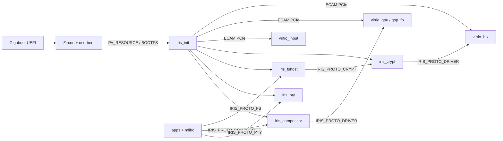

# irisOS Repository Architecture & Symbol Graph

> Auto-generated by `scripts/gen_repo_graph.py`. Query specific items via `./iris graph op|file|target <term>` before reading large files.

## 1. System & IPC Topology

## 2. Build Targets & Dependencies (`build/CMakeLists.txt`)
| Target | Kind | Linked Libraries |
| :--- | :--- | :--- |
| `compiler_rt_builtins` | library | — |
| `freetype` | library | `iris_userland_common` |
| `iris_compositor` | userland_exec | `mlibc`, `iris_static`, `pixman`, `freetype` |
| `iris_crypt` | userland_exec | `mlibc`, `iris_static`, `mbedcrypto` |
| `iris_fshost` | userland_exec | `mlibc`, `iris_static`, `ufs` |
| `iris_gui_static` | library | `iris_userland_common` |
| `iris_init` | executable | — |
| `iris_pty` | userland_exec | `mlibc`, `iris_static` |
| `iris_shell` | userland_exec | `mlibc`, `iris_static` |
| `iris_static` | library | — |
| `iris_userland_common` | library | — |
| `mbedcrypto` | library | — |
| `mkufs2` | host_tool | — |
| `mlibc` | library | — |
| `passphrase` | userland_exec | `mlibc`, `iris_static` |
| `pixman` | library | `iris_userland_common` |
| `terminal` | userland_exec | `mlibc`, `iris_static`, `iris_gui_static`, `pixman`, `freetype` |
| `test_libiris` | executable | `iris_static`, `zircon_static` |
| `ufs` | library | — |
| `virtio_blk` | userland_exec | `mlibc`, `iris_static` |
| `virtio_gpu` | userland_exec | `mlibc`, `iris_static` |
| `zircon_static` | library | — |

## 3. IPC Opcode Dispatch Map (`sdk/libiris/include/iris/ipc.h`)
| Opcode | Def | Handler (`case`) | Callers / References |
| :--- | :--- | :--- | :--- |
| `IRIS_SYS_OP_PING` | `ipc.h:132` | — | `servers/iris_init/src/main.c:1463`, `servers/iris_pty/src/main.c:543` |
| `IRIS_SYS_OP_PONG` | `ipc.h:133` | — | `servers/iris_init/src/main.c:1465`, `servers/iris_pty/src/main.c:546` |
| `IRIS_SYS_OP_SHUTDOWN` | `ipc.h:134` | — | `sdk/mlibc-sysdeps/iris/generic/generic.cpp:3065`, `servers/iris_compositor/src/login.c:435`, `servers/iris_init/src/main.c:1422`, `servers/iris_pty/src/main.c:549` |
| `IRIS_SYS_OP_REBOOT` | `ipc.h:135` | — | `sdk/mlibc-sysdeps/iris/generic/generic.cpp:3062`, `servers/iris_compositor/src/login.c:433`, `servers/iris_init/src/main.c:1422`, `servers/iris_init/src/main.c:1424` |
| `IRIS_SYS_OP_GET_VERSION` | `ipc.h:136` | — | `servers/iris_init/src/main.c:1467` |
| `IRIS_SYS_OP_HEARTBEAT` | `ipc.h:137` | — | — |
| `IRIS_SYS_OP_SESSION_LOGIN` | `ipc.h:138` | — | `servers/iris_compositor/src/login.c:182`, `servers/iris_init/src/main.c:1429` |
| `IRIS_SYS_OP_SESSION_LOGOUT` | `ipc.h:139` | — | `servers/iris_compositor/src/login.c:244`, `servers/iris_init/src/main.c:1455` |
| `IRIS_FS_OP_OPEN` | `ipc.h:154` | `servers/iris_fshost/src/main.c:2650` | `sdk/libiris/tests/test_libiris.c:44`, `sdk/libiris/tests/test_libiris.c:48`, `sdk/libiris/tests/test_libiris.c:61`, `sdk/mlibc-sysdeps/iris/generic/generic.cpp:1748` (+2) |
| `IRIS_FS_OP_CLOSE` | `ipc.h:155` | `servers/iris_fshost/src/main.c:2653` | `sdk/mlibc-sysdeps/iris/generic/generic.cpp:1756`, `sdk/mlibc-sysdeps/iris/generic/generic.cpp:1794`, `servers/iris_init/src/main.c:635`, `servers/iris_init/src/main.c:733` |
| `IRIS_FS_OP_READ` | `ipc.h:156` | `servers/iris_fshost/src/main.c:2656` | `sdk/mlibc-sysdeps/iris/generic/generic.cpp:1498`, `servers/iris_init/src/main.c:608` |
| `IRIS_FS_OP_WRITE` | `ipc.h:157` | `servers/iris_fshost/src/main.c:2659` | `sdk/mlibc-sysdeps/iris/generic/generic.cpp:1390`, `servers/iris_init/src/main.c:707` |
| `IRIS_FS_OP_SEEK` | `ipc.h:158` | `servers/iris_fshost/src/main.c:2662` | `sdk/mlibc-sysdeps/iris/generic/generic.cpp:1954` |
| `IRIS_FS_OP_STAT` | `ipc.h:159` | `servers/iris_fshost/src/main.c:2665` | `sdk/mlibc-sysdeps/iris/generic/generic.cpp:2002`, `sdk/mlibc-sysdeps/iris/generic/generic.cpp:2675` |
| `IRIS_FS_OP_READDIR` | `ipc.h:160` | `servers/iris_fshost/src/main.c:2668` | `sdk/mlibc-sysdeps/iris/generic/generic.cpp:1819` |
| `IRIS_FS_OP_MKDIR` | `ipc.h:161` | `servers/iris_fshost/src/main.c:2671` | `sdk/mlibc-sysdeps/iris/generic/generic.cpp:1843` |
| `IRIS_FS_OP_UNLINK` | `ipc.h:162` | `servers/iris_fshost/src/main.c:2674` | `sdk/mlibc-sysdeps/iris/generic/generic.cpp:1864` |
| `IRIS_FS_OP_RENAME` | `ipc.h:163` | `servers/iris_fshost/src/main.c:2677` | `sdk/mlibc-sysdeps/iris/generic/generic.cpp:1893` |
| `IRIS_FS_OP_TRUNCATE` | `ipc.h:164` | `servers/iris_fshost/src/main.c:2680` | `sdk/mlibc-sysdeps/iris/generic/generic.cpp:1913` |
| `IRIS_FS_OP_SYNC` | `ipc.h:165` | `servers/iris_fshost/src/main.c:2686` | `sdk/mlibc-sysdeps/iris/generic/generic.cpp:3232`, `servers/iris_init/src/main.c:1041` |
| `IRIS_FS_OP_READLINK` | `ipc.h:166` | `servers/iris_fshost/src/main.c:2683` | `sdk/mlibc-sysdeps/iris/generic/generic.cpp:3214` |
| `IRIS_FS_OP_OPEN_CLIENT` | `ipc.h:167` | `servers/iris_fshost/src/main.c:2756` | `sdk/mlibc-sysdeps/iris/generic/generic.cpp:1222`, `servers/iris_init/src/main.c:839` |
| `IRIS_FS_OP_CONFIRM_BOOT` | `ipc.h:168` | `servers/iris_fshost/src/main.c:2750` | `servers/iris_init/src/main.c:863` |
| `IRIS_FS_OP_GET_EXEC_VMO` | `ipc.h:169` | `servers/iris_fshost/src/main.c:2747` | `sdk/mlibc-sysdeps/iris/generic/generic.cpp:1263` |
| `IRIS_FS_OP_LIST_USERS` | `ipc.h:170` | `servers/iris_fshost/src/main.c:2699` | `servers/iris_compositor/src/login.c:74` |
| `IRIS_FS_OP_USER_LOGIN` | `ipc.h:171` | `servers/iris_fshost/src/main.c:2715` | `servers/iris_compositor/src/login.c:146` |
| `IRIS_FS_OP_USER_LOGOUT` | `ipc.h:172` | `servers/iris_fshost/src/main.c:2736` | `servers/iris_init/src/main.c:1009` |
| `IRIS_CRYPT_OP_STATUS` | `ipc.h:381` | `servers/iris_crypt/src/main.c:682` | — |
| `IRIS_CRYPT_OP_UNLOCK` | `ipc.h:382` | `servers/iris_crypt/src/main.c:691` | `servers/iris_crypt/src/main.c:1060`, `apps/sysutils/passphrase/main.c:60` |
| `IRIS_CRYPT_OP_LOCK` | `ipc.h:383` | `servers/iris_crypt/src/main.c:709` | `servers/iris_init/src/main.c:1025` |
| `IRIS_CRYPT_OP_UNLOCK_USER` | `ipc.h:384` | `servers/iris_crypt/src/main.c:722` | `servers/iris_fshost/src/user_session.c:842` |
| `IRIS_CRYPT_OP_LOCK_USER` | `ipc.h:385` | `servers/iris_crypt/src/main.c:752` | `servers/iris_fshost/src/user_session.c:924` |
| `IRIS_CRYPT_OP_CRYPT_SECTORS` | `ipc.h:386` | `servers/iris_crypt/src/main.c:763` | `servers/iris_fshost/src/user_session.c:579` |
| `IRIS_COMPOSITOR_OP_CREATE_WINDOW` | `ipc.h:437` | `servers/iris_compositor/src/main.c:487` | `sdk/libiris_gui/src/gui.c:160` |
| `IRIS_COMPOSITOR_OP_DESTROY_WINDOW` | `ipc.h:438` | `servers/iris_compositor/src/main.c:509` | `sdk/libiris_gui/src/gui.c:201` |
| `IRIS_COMPOSITOR_OP_DAMAGE` | `ipc.h:439` | `servers/iris_compositor/src/main.c:524` | `sdk/libiris_gui/src/gui.c:249` |
| `IRIS_COMPOSITOR_OP_MOVE_WINDOW` | `ipc.h:440` | `servers/iris_compositor/src/main.c:539` | `sdk/libiris_gui/src/gui.c:280` |
| `IRIS_COMPOSITOR_OP_OPEN_CLIENT` | `ipc.h:441` | `servers/iris_compositor/src/main.c:572` | `sdk/mlibc-sysdeps/iris/generic/generic.cpp:1299`, `servers/iris_init/src/main.c:791` |
| `IRIS_COMPOSITOR_OP_POLL_EVENT` | `ipc.h:442` | `servers/iris_compositor/src/main.c:554` | `sdk/libiris_gui/src/gui.c:307` |
| `IRIS_COMPOSITOR_OP_SET_BOOT_STAGE` | `ipc.h:443` | `servers/iris_compositor/src/main.c:602` | `servers/iris_init/src/main.c:985` |
| `IRIS_PTY_OP_READ` | `ipc.h:528` | `servers/iris_pty/src/main.c:567` | `sdk/libiris/src/pty.c:131`, `sdk/mlibc-sysdeps/iris/generic/generic.cpp:1464` |
| `IRIS_PTY_OP_WRITE` | `ipc.h:529` | `servers/iris_pty/src/main.c:613` | `sdk/libiris/src/pty.c:170`, `sdk/mlibc-sysdeps/iris/generic/generic.cpp:1357` |
| `IRIS_PTY_OP_SET_WINDOW` | `ipc.h:530` | `servers/iris_pty/src/main.c:698` | `sdk/libiris/src/pty.c:60` |
| `IRIS_PTY_OP_GET_WINDOW` | `ipc.h:531` | `servers/iris_pty/src/main.c:710` | `sdk/libiris/src/pty.c:72` |
| `IRIS_PTY_OP_DRAIN` | `ipc.h:532` | `servers/iris_pty/src/main.c:724` | — |
| `IRIS_PTY_OP_SIGNAL` | `ipc.h:533` | `servers/iris_pty/src/main.c:731` | `sdk/libiris/src/pty.c:112` |
| `IRIS_PTY_OP_SET_MODE` | `ipc.h:534` | `servers/iris_pty/src/main.c:663` | `sdk/libiris/src/pty.c:29`, `sdk/mlibc-sysdeps/iris/generic/generic.cpp:2992` |
| `IRIS_PTY_OP_GET_MODE` | `ipc.h:535` | `servers/iris_pty/src/main.c:684` | `sdk/libiris/src/pty.c:41`, `sdk/mlibc-sysdeps/iris/generic/generic.cpp:2961` |
| `IRIS_PTY_OP_INJECT` | `ipc.h:536` | `servers/iris_pty/src/main.c:746` | `sdk/libiris/src/pty.c:98` |
| `IRIS_PTY_OP_OPEN_CLIENT` | `ipc.h:537` | `servers/iris_pty/src/main.c:769` | `sdk/mlibc-sysdeps/iris/generic/generic.cpp:1186`, `servers/iris_init/src/main.c:815` |
| `IRIS_PTY_OP_READ_OUTPUT` | `ipc.h:538` | `servers/iris_pty/src/main.c:635` | `sdk/libiris/src/pty.c:187` |
| `IRIS_BLK_OP_GET_INFO` | `ipc.h:616` | `servers/drivers/virtio_blk/src/main.c:538`, `servers/iris_crypt/src/main.c:810` | `servers/iris_crypt/src/main.c:111`, `servers/iris_fshost/src/main.c:197`, `servers/iris_init/src/main.c:768` |
| `IRIS_BLK_OP_READ` | `ipc.h:617` | `servers/drivers/virtio_blk/src/main.c:571`, `servers/iris_crypt/src/main.c:878` | `servers/iris_crypt/src/main.c:154`, `servers/iris_fshost/src/main.c:226`, `servers/iris_fshost/src/ufs_io.c:114` |
| `IRIS_BLK_OP_WRITE` | `ipc.h:618` | `servers/drivers/virtio_blk/src/main.c:549`, `servers/iris_crypt/src/main.c:821` | `servers/iris_crypt/src/main.c:210`, `servers/iris_fshost/src/main.c:263`, `servers/iris_fshost/src/ufs_io.c:167` |
| `IRIS_BLK_OP_FLUSH` | `ipc.h:619` | `servers/drivers/virtio_blk/src/main.c:592`, `servers/iris_crypt/src/main.c:936` | `servers/iris_crypt/src/main.c:249`, `servers/iris_fshost/src/main.c:289`, `servers/iris_fshost/src/ufs_io.c:332` |
| `IRIS_GPU_OP_GET_INFO` | `ipc.h:621` | `servers/drivers/virtio_gpu/src/main.c:810` | `servers/iris_compositor/src/render.c:479`, `servers/iris_init/src/main.c:777` |
| `IRIS_GPU_OP_FLUSH` | `ipc.h:622` | `servers/drivers/virtio_gpu/src/main.c:828` | `servers/iris_compositor/src/render.c:553` |
| `IRIS_GPU_OP_MOVE_CURSOR` | `ipc.h:623` | `servers/drivers/virtio_gpu/src/main.c:842` | — |

## 4. Large-File Function Maps (Files > 250 LOC)
Use these exact `Lstart-Lend` ranges with `read_file` instead of reading whole files.

### `apps/terminal/main.c` (1116 LOC)
`block_glyph_index` (L210-L225), `apply_term_var_weight` (L246-L266), `init_terminal_font` (L268-L287), `get_term_glyph` (L289-L327), `clear_cell` (L361-L366), `mark_all_rows_dirty` (L368-L372), `term_reset_grid` (L374-L387), `term_scroll_up` (L389-L401), `term_newline` (L403-L411), `term_put_char` (L413-L441), `handle_sgr` (L443-L470), `handle_csi_dispatch` (L472-L556), `term_feed_byte` (L558-L630), `fill_rect_raw` (L636-L662), `draw_codename_banner_raw` (L664-L687), `draw_glyph_cell` (L689-L770), `find_prompt_prefix_end` (L777-L797), `draw_proportional_run` (L799-L852), `render_terminal_surface` (L854-L950), `spawn_interactive_shell` (L956-L1017), `main` (L1023-L1116)

### `sdk/libiris/src/channel.c` (443 LOC)
`iris_memcpy` (L30-L37), `iris_channel_create` (L39-L50), `iris_channel_send` (L52-L127), `iris_channel_recv` (L129-L258), `iris_channel_call` (L260-L422), `iris_channel_send_simple` (L424-L431), `iris_channel_reply` (L433-L443)

### `sdk/libiris/src/spawn.c` (592 LOC)
`iris_strlen` (L71-L78), `iris_memcpy` (L80-L87), `iris_memset` (L89-L95), `iris_elf_load_segments` (L106-L267), `iris_spawn` (L269-L541), `iris_spawn_elf` (L543-L569), `iris_spawn_simple` (L571-L592)

### `sdk/libiris_gui/src/gui.c` (319 LOC)
`iris_gui_set_channel` (L35-L37), `iris_gui_get_channel` (L39-L54), `iris_window_create_ex` (L56-L182), `iris_window_create` (L184-L186), `iris_window_destroy` (L188-L228), `iris_window_damage` (L230-L257), `iris_window_get_surface` (L259-L264), `iris_window_move` (L266-L292), `iris_window_poll_event` (L294-L319)

### `sdk/mlibc-sysdeps/iris/generic/entry.cpp` (474 LOC)
`self_relocate` (L61-L100), `run_init_array` (L102-L112), `__iris_start` (L122-L457), `__mlibc_entry` (L462-L474)

### `sdk/mlibc-sysdeps/iris/generic/generic.cpp` (3274 LOC)
`iris_set_compositor_channel` (L78-L80), `iris_get_compositor_channel` (L82-L87), `iris_get_bootfs_vmo` (L89-L91), `iris_set_vmar_root` (L93-L95), `iris_set_job_default` (L97-L99), `iris_set_vdso_vmo` (L101-L103), `iris_set_bootfs_vmo` (L105-L107), `iris_set_fshost_channel` (L109-L111), `iris_get_fshost_channel` (L113-L118), `iris_set_pty_channel` (L120-L122), `iris_set_system_channel` (L126-L128), `iris_get_system_channel` (L130-L135), `iris_get_pty_channel` (L139-L152), `iris_get_debuglog` (L154-L159), `iris_fd_table_init` (L168-L196), `iris_set_debuglog` (L198-L208), `iris_fd_bind` (L210-L225), `iris_fd_alloc` (L227-L241), `iris_fd_get` (L243-L251), `iris_fd_get_handle` (L253-L259), `iris_fd_close` (L261-L274), `iris_fd_count_open` (L276-L287), `iris_init_startup_handles` (L289-L298), `zx_take_startup_handle` (L300-L310), `iris_set_process_handles` (L314-L322), `zx_process_self` (L324-L329), `zx_thread_self` (L331-L336), `zx_vmar_root_self` (L338-L343), `zx_job_default` (L345-L350), `vdso_sym_lookup` (L407-L463), `vdso_find` (L528-L534), `iris_vdso_init` (L536-L583), `zx_system_powerctl` (L585-L590), `zx_channel_read` (L593-L600), `zx_channel_write` (L602-L608), `zx_channel_create` (L610-L615), `zx_channel_call` (L617-L624), `zx_handle_close` (L626-L631), `zx_handle_duplicate` (L633-L638), `zx_socket_create` (L640-L645), `zx_socket_write` (L647-L652), `zx_socket_read` (L654-L659), `zx_debuglog_write` (L661-L666), `zx_vmo_create` (L668-L673), `zx_vmo_replace_as_executable` (L675-L680), `zx_vmo_get_size` (L682-L687), `zx_vmo_set_size` (L689-L694), `zx_vmo_read` (L696-L701), `zx_vmo_write` (L703-L708), `zx_vmar_map` (L710-L716), `zx_vmar_unmap` (L718-L723), `zx_vmar_allocate` (L725-L732), `zx_process_create` (L734-L740), `zx_process_start` (L742-L749), `zx_process_exit` (L751-L758), `zx_thread_create` (L760-L766), `zx_thread_start` (L768-L774), `zx_thread_exit` (L776-L783), `zx_object_set_property` (L785-L790), `zx_nanosleep` (L792-L797), `zx_clock_get` (L799-L804), `zx_clock_get_monotonic` (L806-L814), `zx_deadline_after` (L816-L819), `zx_futex_wait` (L821-L826), `zx_futex_wake` (L828-L833), `zx_vmo_create_physical` (L835-L838), `zx_vmo_create_contiguous` (L840-L843), `zx_iommu_create` (L845-L848), `zx_bti_create` (L850-L853), `zx_bti_pin` (L855-L858), `zx_pmt_unpin` (L860-L863), `zx_object_wait_one` (L865-L868), `zx_object_wait_many` (L870-L873), `zx_debug_read` (L875-L878), `zx_debug_write` (L880-L883), `zx_object_get_info` (L885-L888), `zx_task_kill` (L890-L893), `sys_sync` (L3256-L3258), `sys_fsync` (L3260-L3262), `sys_fdatasync` (L3264-L3266), `sys_syncfs` (L3268-L3270), `sys_reboot` (L3272-L3274)

### `servers/drivers/virtio_blk/src/main.c` (672 LOC)
`virtio_blk_do_io` (L131-L201), `init_virtio_block_device` (L206-L410), `cleanup_virtio_block_device` (L419-L444), `run_ipc_server` (L453-L630), `main` (L632-L672)

### `servers/drivers/virtio_gpu/src/main.c` (943 LOC)
`align_page` (L97-L99), `virtio_gpu_exec_cmd` (L163-L231), `virtio_gpu_flush_rect` (L237-L276), `virtio_gpu_move_cursor` (L281-L324), `init_virtio_gpu_device` (L330-L670), `cleanup_virtio_gpu_device` (L675-L715), `run_ipc_server` (L723-L887), `main` (L889-L943)

### `servers/drivers/virtio_input/src/virtio_input.c` (479 LOC)
`align_page` (L30-L32), `virtio_input_translate_key` (L34-L144), `virtio_input_init_nth` (L146-L323), `virtio_input_init` (L325-L327), `virtio_input_poll_raw` (L329-L368), `virtio_input_poll` (L370-L453), `virtio_input_teardown` (L455-L479)

### `servers/iris_compositor/src/font.c` (875 LOC)
`draw_string_8x8` (L121-L152), `apply_variable_axes` (L158-L191), `load_face_with_fallback` (L193-L205), `init_material_icons_from_memory` (L207-L221), `init_ui_font_from_memory` (L223-L237), `init_font_subsystem` (L239-L310), `free_bucket_glyphs` (L355-L363), `resolve_face` (L365-L371), `get_cached_glyph` (L373-L451), `get_cached_material_glyph` (L453-L523), `cleanup_font_subsystem` (L539-L589), `blend_glyph_bitmap` (L591-L662), `decode_utf8_cp` (L664-L693), `get_cached_unicode_glyph` (L695-L762), `draw_text_ft_ex` (L764-L804), `measure_text_ft_ex` (L806-L828), `draw_material_icon` (L830-L848), `draw_text_ft_styled` (L850-L868), `draw_text_ft` (L870-L875)

### `servers/iris_compositor/src/input.c` (527 LOC)
`uart_lock` (L17-L19), `uart_unlock` (L21-L23), `uart_rx_thread_entry` (L25-L46), `init_input_subsystems` (L52-L104), `route_key_to_focused_window` (L110-L151), `handle_mouse_button` (L157-L321), `poll_input_devices` (L327-L527)

### `servers/iris_compositor/src/login.c` (492 LOC)
`free_avatar_cache` (L37-L44), `load_user_avatars` (L46-L67), `fetch_user_list` (L69-L113), `send_sys_op` (L115-L134), `attempt_user_login` (L136-L205), `login_init` (L207-L210), `login_set_fs_channel` (L212-L214), `login_show` (L216-L224), `login_is_active` (L226-L228), `login_active_username` (L230-L232), `login_active_display_name` (L234-L236), `login_active_is_guest` (L238-L240), `login_trigger_logout` (L242-L248), `draw_circular_avatar` (L250-L276), `login_render` (L278-L388), `login_handle_click` (L390-L442), `login_handle_key` (L444-L492)

### `servers/iris_compositor/src/main.c` (868 LOC)
`load_boot_splash_assets_from_vmo` (L30-L69), `find_window` (L145-L153), `release_window_resources` (L155-L169), `destroy_client_windows` (L171-L192), `window_push_key` (L194-L201), `window_pop_key` (L203-L209), `handle_create_window` (L215-L300), `handle_destroy_window` (L302-L325), `handle_damage_window` (L327-L358), `handle_move_window` (L360-L384), `handle_poll_event` (L386-L409), `run_compositor_loop` (L415-L735), `main` (L741-L868)

### `servers/iris_compositor/src/render.c` (2197 LOC)
`point_in_cursor_poly` (L33-L44), `min_dist_sq_to_cursor_poly` (L46-L65), `init_cursor_sprite` (L67-L154), `argb_to_pixman_color` (L160-L167), `fill_rect_pixman` (L169-L218), `alpha_blend_pixel` (L220-L236), `compute_pixel_clip` (L238-L252), `fill_rect_vgradient_over` (L254-L303), `fill_rounded_rect_over` (L305-L370), `fill_circle_over` (L372-L410), `blit_surface_clamped` (L412-L463), `connect_to_virtio_gpu` (L469-L536), `flush_gpu_scanout` (L538-L561), `dirty_rect_union` (L567-L592), `dirty_rect_union_window` (L594-L599), `block_glyph_index` (L626-L641), `draw_codename_banner` (L643-L665), `redraw_welcome_input_strip` (L667-L681), `render_welcome_surface_contents` (L683-L700), `close_crash_dialog` (L702-L715), `render_crash_dialog_contents` (L717-L770), `init_crash_dialog` (L772-L805), `set_boot_splash_eye_svg` (L817-L831), `render_boot_splash_ex` (L839-L953), `render_boot_splash` (L955-L957), `blend_crossfade_rect` (L971-L991), `compositor_capture_boot_splash_frame` (L993-L1001), `compositor_invalidate_crossfade_target` (L1003-L1007), `compositor_begin_boot_to_login_crossfade` (L1009-L1029), `compositor_start_wallpaper_crossfade` (L1031-L1038), `compositor_tick_wallpaper_crossfade` (L1040-L1043), `load_qoi_wallpaper_aspect_fill` (L1049-L1197), `svg_skip_ws` (L1228-L1231), `svg_parse_float` (L1233-L1254), `svg_add_seg` (L1256-L1260), `svg_parse_path_string` (L1262-L1328), `svg_point_in_poly` (L1330-L1341), `svg_parse_viewbox_and_grad` (L1352-L1390), `render_svg_internal` (L1392-L1572), `render_boot_logo_svg` (L1574-L1578), `render_eye_svg` (L1580-L1585), `render_eye_light_svg` (L1587-L1590), `draw_line_thick` (L1596-L1610), `init_desktop_wallpaper` (L1612-L1679), `rects_intersect` (L1687-L1694), `rect_contains` (L1696-L1702), `composite_window` (L1704-L1838), `clamp_rect_to_screen` (L1844-L1877), `expand_flush_bounds` (L1879-L1895), `update_screen` (L1897-L2010), `composite_and_flush` (L2012-L2197)

### `servers/iris_compositor/src/taskbar.c` (1392 LOC)
`draw_line_thick_tb` (L120-L134), `draw_tray_glyph` (L136-L145), `draw_app_icon` (L147-L178), `save_pinned_apps` (L184-L199), `maybe_load_pinned_apps` (L201-L251), `find_app_by_id` (L253-L261), `record_recent_app` (L263-L288), `taskbar_push_notification` (L294-L316), `taskbar_set_privacy_active` (L318-L328), `taskbar_wake_from_sleep` (L330-L335), `taskbar_enter_sleep` (L337-L340), `add_catalog_app` (L346-L358), `taskbar_init` (L360-L375), `taskbar_update_clock` (L377-L414), `taskbar_sync_windows` (L416-L490), `get_dock_start_x` (L492-L498), `launch_or_focus_app` (L504-L544), `taskbar_render` (L550-L661), `taskbar_has_active_flyout` (L667-L669), `taskbar_has_active_overlay` (L671-L673), `taskbar_close_flyout` (L675-L680), `open_flyout` (L682-L697), `draw_flyout_card` (L699-L702), `render_calendar_flyout` (L704-L744), `taskbar_render_flyout` (L746-L989), `dirty_drag_ghost_at` (L995-L997), `taskbar_handle_mouse_down` (L999-L1233), `taskbar_update_hover` (L1235-L1275), `taskbar_handle_mouse_move` (L1277-L1317), `taskbar_handle_mouse_up` (L1319-L1386), `taskbar_handle_click` (L1388-L1392)

### `servers/iris_crypt/src/main.c` (1089 LOC)
`downstream_get_info` (L109-L144), `downstream_read_sectors` (L149-L194), `downstream_write_sectors` (L199-L242), `downstream_flush` (L247-L273), `make_xts_data_unit` (L283-L288), `compute_header_checksum` (L294-L297), `detect_gpt_data_partition` (L303-L335), `zeroize_user_slot` (L354-L362), `unlock_user_header` (L364-L455), `unlock_with_passphrase` (L457-L658), `handle_client_request` (L664-L948), `run_proxy_server` (L950-L1004), `main` (L1006-L1089)

### `servers/iris_fshost/src/main.c` (2889 LOC)
`get_mount_disk` (L180-L184), `is_mount_rw` (L186-L188), `blk_get_info` (L194-L218), `blk_read_sectors` (L220-L251), `blk_write_sectors` (L253-L284), `blk_flush` (L286-L305), `calc_gpt_crc32` (L307-L321), `utf16le_to_ascii` (L327-L333), `parse_gpt_partitions` (L335-L417), `confirm_gpt_boot_slot` (L423-L483), `init_uufsd_struct` (L489-L497), `mount_data_partition` (L499-L530), `mount_filesystems` (L532-L563), `ufs2_dir_lookup` (L568-L610), `ufs2_alloc_block` (L615-L654), `ufs2_create_file` (L659-L758), `ufs2_mkdir` (L763-L913), `ufs2_unlink` (L918-L1049), `expand_virtual_symlinks` (L1058-L1070), `resolve_vfs_path` (L1076-L1218), `handle_fs_open` (L1224-L1391), `handle_fs_close` (L1393-L1410), `ufs2_invalidate_indirect_cache` (L1428-L1435), `ufs2_lookup_lbn_frag` (L1437-L1486), `handle_fs_read` (L1488-L1596), `handle_fs_write` (L1598-L1772), `handle_fs_seek` (L1774-L1812), `handle_fs_stat` (L1814-L1913), `handle_fs_readdir` (L1915-L2051), `handle_fs_mkdir` (L2053-L2097), `handle_fs_unlink` (L2099-L2139), `ufs2_dir_remove_entry` (L2141-L2174), `ufs2_dir_insert_entry` (L2176-L2222), `handle_fs_rename` (L2224-L2318), `handle_fs_truncate` (L2320-L2359), `handle_fs_readlink` (L2361-L2455), `handle_fs_get_exec_vmo` (L2472-L2626), `dispatch_fs_message` (L2632-L2792), `run_vfs_server` (L2794-L2843), `main` (L2845-L2889)

### `servers/iris_fshost/src/ufs_io.c` (405 LOC)
`iris_ufs_register_device` (L51-L66), `iris_ufs_register_custom` (L68-L86), `iris_ufs_unregister_device` (L88-L91), `dev_read_sectors` (L96-L99), `dev_write_sectors` (L101-L104), `ipc_read_sectors` (L109-L151), `ipc_write_sectors` (L156-L193), `iris_ufs_pread` (L195-L253), `iris_ufs_pwrite` (L255-L321), `iris_ufs_flush_device` (L323-L349), `ufs_disk_write` (L360-L369), `ufs_disk_close` (L371-L386), `calculate_crc32c` (L391-L405)

### `servers/iris_fshost/src/user_session.c` (954 LOC)
`ramfs_clear_subtree` (L53-L80), `ramfs_init` (L82-L101), `ramfs_reset_guest` (L103-L106), `ramfs_handles_path` (L108-L133), `ramfs_find_child` (L135-L144), `ramfs_alloc_node` (L146-L160), `ramfs_resolve` (L162-L227), `ramfs_open` (L229-L256), `ramfs_read` (L258-L273), `ramfs_write` (L275-L298), `ramfs_stat` (L300-L309), `ramfs_stat_path` (L311-L316), `ramfs_readdir` (L318-L373), `ramfs_mkdir` (L375-L383), `ramfs_unlink` (L385-L404), `ramfs_rename` (L406-L428), `ramfs_truncate` (L430-L446), `ufs2_lookup_dir_entry` (L461-L490), `ufs2_lookup_abs` (L492-L509), `ufs2_cache_file_blocks` (L511-L563), `vault_crypt_ipc` (L565-L610), `vault_read_raw_sectors` (L612-L633), `vault_write_raw_sectors` (L635-L661), `vault_custom_read` (L663-L677), `vault_custom_write` (L679-L693), `vault_custom_flush` (L695-L697), `trim_cr` (L703-L708), `user_session_list_users` (L710-L787), `user_session_login` (L789-L902), `user_session_logout` (L904-L949)

### `servers/iris_init/src/main.c` (1584 LOC)
`vdso_lookup` (L90-L117), `vdso_find` (L119-L122), `vdso_init` (L157-L172), `iris_deadline_after` (L174-L177), `iris_memcpy` (L183-L187), `iris_memset` (L189-L192), `iris_memcmp` (L194-L198), `iris_strlen` (L200-L203), `iris_strcmp` (L205-L208), `buf_putc` (L210-L213), `vsnprintf` (L215-L253), `snprintf` (L255-L259), `log_line` (L261-L276), `log_status` (L278-L301), `find_bootfs_entry` (L312-L338), `add_handle` (L340-L345), `spawn_process_from_elf` (L351-L523), `spawn_bootfs_binary` (L529-L536), `vfs_read_file_to_vmo` (L541-L653), `vfs_write_file_from_buffer` (L655-L743), `spawn_vfs_binary` (L749-L765), `register_blk_client` (L767-L773), `register_gpu_client` (L775-L785), `request_compositor_client_channel` (L787-L809), `request_pty_client_channel` (L811-L833), `request_fs_client_channel` (L835-L857), `confirm_boot_with_fshost` (L859-L877), `rtc_outb` (L879-L885), `rtc_inb` (L887-L895), `init_hardware_rtc` (L897-L974), `send_compositor_boot_stage` (L976-L1004), `send_fshost_user_logout` (L1006-L1020), `send_crypt_lock` (L1022-L1036), `send_fshost_sync` (L1038-L1052), `stop_process_gracefully` (L1054-L1075), `spawn_compositor` (L1077-L1141)

### `servers/iris_pty/src/main.c` (956 LOC)
`pty_lock` (L63-L67), `pty_unlock` (L69-L71), `out_push_unlocked` (L73-L83), `out_pop_unlocked` (L85-L91), `pty_raw_output` (L93-L103), `ready_push` (L105-L111), `ready_pop` (L113-L119), `pty_replace_line` (L121-L142), `pty_feed_char` (L144-L392), `pty_try_fulfill_pending_reads` (L397-L444), `uart_rx_thread_entry` (L449-L465), `init_uart_fallback` (L470-L517), `handle_pty_message` (L522-L804), `main` (L806-L956)
