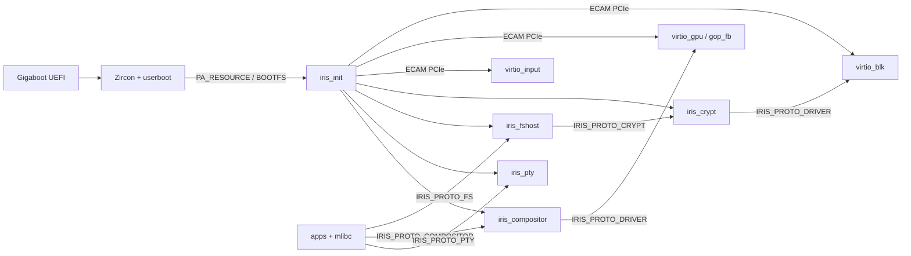

# irisOS Repository Architecture & Symbol Graph

> Auto-generated by `scripts/gen_repo_graph.py`. Query specific items via `./iris graph op|file|target <term>` before reading large files.

## 1. System & IPC Topology

## 2. Build Targets & Dependencies (`build/CMakeLists.txt`)
| Target | Kind | Linked Libraries |
| :--- | :--- | :--- |
| `compiler_rt_builtins` | library | — |
| `freetype` | library | `iris_userland_common` |
| `iris_compositor` | userland_exec | `mlibc`, `iris_static`, `pixman`, `freetype` |
| `iris_crypt` | userland_exec | `mlibc`, `iris_static`, `mbedcrypto` |
| `iris_fshost` | userland_exec | `mlibc`, `iris_static`, `ufs` |
| `iris_gui_static` | library | `iris_userland_common` |
| `iris_init` | executable | — |
| `iris_pty` | userland_exec | `mlibc`, `iris_static` |
| `iris_shell` | userland_exec | `mlibc`, `iris_static` |
| `iris_static` | library | — |
| `iris_userland_common` | library | — |
| `mbedcrypto` | library | — |
| `mkufs2` | host_tool | — |
| `mlibc` | library | — |
| `passphrase` | userland_exec | `mlibc`, `iris_static` |
| `pixman` | library | `iris_userland_common` |
| `terminal` | userland_exec | `mlibc`, `iris_static`, `iris_gui_static`, `pixman`, `freetype` |
| `test_libiris` | executable | `iris_static`, `zircon_static` |
| `ufs` | library | — |
| `virtio_blk` | userland_exec | `mlibc`, `iris_static` |
| `virtio_gpu` | userland_exec | `mlibc`, `iris_static` |
| `zircon_static` | library | — |

## 3. IPC Opcode Dispatch Map (`sdk/libiris/include/iris/ipc.h`)
| Opcode | Def | Handler (`case`) | Callers / References |
| :--- | :--- | :--- | :--- |
| `IRIS_SYS_OP_PING` | `ipc.h:132` | — | `servers/iris_pty/src/main.c:543` |
| `IRIS_SYS_OP_PONG` | `ipc.h:133` | — | `servers/iris_pty/src/main.c:546` |
| `IRIS_SYS_OP_SHUTDOWN` | `ipc.h:134` | — | `servers/iris_pty/src/main.c:549` |
| `IRIS_SYS_OP_REBOOT` | `ipc.h:135` | — | — |
| `IRIS_SYS_OP_GET_VERSION` | `ipc.h:136` | — | — |
| `IRIS_SYS_OP_HEARTBEAT` | `ipc.h:137` | — | — |
| `IRIS_FS_OP_OPEN` | `ipc.h:142` | `servers/iris_fshost/src/main.c:2243` | `sdk/libiris/tests/test_libiris.c:44`, `sdk/libiris/tests/test_libiris.c:48`, `sdk/libiris/tests/test_libiris.c:61`, `sdk/mlibc-sysdeps/iris/generic/generic.cpp:1735` (+2) |
| `IRIS_FS_OP_CLOSE` | `ipc.h:143` | `servers/iris_fshost/src/main.c:2246` | `sdk/mlibc-sysdeps/iris/generic/generic.cpp:1743`, `sdk/mlibc-sysdeps/iris/generic/generic.cpp:1781`, `servers/iris_init/src/main.c:642`, `servers/iris_init/src/main.c:740` |
| `IRIS_FS_OP_READ` | `ipc.h:144` | `servers/iris_fshost/src/main.c:2249` | `sdk/mlibc-sysdeps/iris/generic/generic.cpp:1485`, `servers/iris_init/src/main.c:615` |
| `IRIS_FS_OP_WRITE` | `ipc.h:145` | `servers/iris_fshost/src/main.c:2252` | `sdk/mlibc-sysdeps/iris/generic/generic.cpp:1377`, `servers/iris_init/src/main.c:714` |
| `IRIS_FS_OP_SEEK` | `ipc.h:146` | `servers/iris_fshost/src/main.c:2255` | `sdk/mlibc-sysdeps/iris/generic/generic.cpp:1902` |
| `IRIS_FS_OP_STAT` | `ipc.h:147` | `servers/iris_fshost/src/main.c:2258` | `sdk/mlibc-sysdeps/iris/generic/generic.cpp:1950`, `sdk/mlibc-sysdeps/iris/generic/generic.cpp:2611` |
| `IRIS_FS_OP_READDIR` | `ipc.h:148` | `servers/iris_fshost/src/main.c:2261` | `sdk/mlibc-sysdeps/iris/generic/generic.cpp:1806` |
| `IRIS_FS_OP_MKDIR` | `ipc.h:149` | `servers/iris_fshost/src/main.c:2264` | `sdk/mlibc-sysdeps/iris/generic/generic.cpp:1830` |
| `IRIS_FS_OP_UNLINK` | `ipc.h:150` | `servers/iris_fshost/src/main.c:2267` | `sdk/mlibc-sysdeps/iris/generic/generic.cpp:1851` |
| `IRIS_FS_OP_RENAME` | `ipc.h:151` | — | — |
| `IRIS_FS_OP_TRUNCATE` | `ipc.h:152` | — | — |
| `IRIS_FS_OP_SYNC` | `ipc.h:153` | `servers/iris_fshost/src/main.c:2273` | `sdk/mlibc-sysdeps/iris/generic/generic.cpp:3154` |
| `IRIS_FS_OP_READLINK` | `ipc.h:154` | `servers/iris_fshost/src/main.c:2270` | `sdk/mlibc-sysdeps/iris/generic/generic.cpp:3136` |
| `IRIS_FS_OP_OPEN_CLIENT` | `ipc.h:155` | `servers/iris_fshost/src/main.c:2289` | `sdk/mlibc-sysdeps/iris/generic/generic.cpp:1209`, `servers/iris_init/src/main.c:846` |
| `IRIS_FS_OP_CONFIRM_BOOT` | `ipc.h:156` | `servers/iris_fshost/src/main.c:2283` | `servers/iris_init/src/main.c:870` |
| `IRIS_FS_OP_GET_EXEC_VMO` | `ipc.h:157` | `servers/iris_fshost/src/main.c:2280` | `sdk/mlibc-sysdeps/iris/generic/generic.cpp:1250` |
| `IRIS_CRYPT_OP_STATUS` | `ipc.h:315` | `servers/iris_crypt/src/main.c:562` | — |
| `IRIS_CRYPT_OP_UNLOCK` | `ipc.h:316` | `servers/iris_crypt/src/main.c:571` | `servers/iris_crypt/src/main.c:861`, `apps/sysutils/passphrase/main.c:60` |
| `IRIS_CRYPT_OP_LOCK` | `ipc.h:317` | `servers/iris_crypt/src/main.c:589` | — |
| `IRIS_CRYPT_OP_READ` | `ipc.h:318` | — | — |
| `IRIS_CRYPT_OP_WRITE` | `ipc.h:319` | — | — |
| `IRIS_COMPOSITOR_OP_CREATE_WINDOW` | `ipc.h:343` | `servers/iris_compositor/src/main.c:425` | `sdk/libiris_gui/src/gui.c:160` |
| `IRIS_COMPOSITOR_OP_DESTROY_WINDOW` | `ipc.h:344` | `servers/iris_compositor/src/main.c:447` | `sdk/libiris_gui/src/gui.c:201` |
| `IRIS_COMPOSITOR_OP_DAMAGE` | `ipc.h:345` | `servers/iris_compositor/src/main.c:462` | `sdk/libiris_gui/src/gui.c:249` |
| `IRIS_COMPOSITOR_OP_MOVE_WINDOW` | `ipc.h:346` | `servers/iris_compositor/src/main.c:477` | `sdk/libiris_gui/src/gui.c:280` |
| `IRIS_COMPOSITOR_OP_OPEN_CLIENT` | `ipc.h:347` | `servers/iris_compositor/src/main.c:510` | `sdk/mlibc-sysdeps/iris/generic/generic.cpp:1286`, `servers/iris_init/src/main.c:798` |
| `IRIS_COMPOSITOR_OP_POLL_EVENT` | `ipc.h:348` | `servers/iris_compositor/src/main.c:492` | `sdk/libiris_gui/src/gui.c:307` |
| `IRIS_COMP_OP_CREATE` | `ipc.h:351` | — | — |
| `IRIS_COMP_OP_DESTROY` | `ipc.h:352` | — | — |
| `IRIS_COMP_OP_DAMAGE` | `ipc.h:353` | — | — |
| `IRIS_COMP_OP_MOVE` | `ipc.h:354` | — | — |
| `IRIS_COMP_OP_POLL_EVENT` | `ipc.h:355` | — | — |
| `IRIS_PTY_OP_READ` | `ipc.h:431` | `servers/iris_pty/src/main.c:567` | `sdk/libiris/src/pty.c:131`, `sdk/mlibc-sysdeps/iris/generic/generic.cpp:1451` |
| `IRIS_PTY_OP_WRITE` | `ipc.h:432` | `servers/iris_pty/src/main.c:613` | `sdk/libiris/src/pty.c:170`, `sdk/mlibc-sysdeps/iris/generic/generic.cpp:1344` |
| `IRIS_PTY_OP_SET_WINDOW` | `ipc.h:433` | `servers/iris_pty/src/main.c:698` | `sdk/libiris/src/pty.c:60` |
| `IRIS_PTY_OP_GET_WINDOW` | `ipc.h:434` | `servers/iris_pty/src/main.c:710` | `sdk/libiris/src/pty.c:72` |
| `IRIS_PTY_OP_DRAIN` | `ipc.h:435` | `servers/iris_pty/src/main.c:724` | — |
| `IRIS_PTY_OP_SIGNAL` | `ipc.h:436` | `servers/iris_pty/src/main.c:731` | `sdk/libiris/src/pty.c:112` |
| `IRIS_PTY_OP_SET_MODE` | `ipc.h:437` | `servers/iris_pty/src/main.c:663` | `sdk/libiris/src/pty.c:29`, `sdk/mlibc-sysdeps/iris/generic/generic.cpp:2928` |
| `IRIS_PTY_OP_SET_ATTR` | `ipc.h:438` | — | — |
| `IRIS_PTY_OP_GET_MODE` | `ipc.h:439` | `servers/iris_pty/src/main.c:684` | `sdk/libiris/src/pty.c:41`, `sdk/mlibc-sysdeps/iris/generic/generic.cpp:2897` |
| `IRIS_PTY_OP_INJECT` | `ipc.h:440` | `servers/iris_pty/src/main.c:746` | `sdk/libiris/src/pty.c:98` |
| `IRIS_PTY_OP_OPEN_CLIENT` | `ipc.h:441` | `servers/iris_pty/src/main.c:769` | `sdk/mlibc-sysdeps/iris/generic/generic.cpp:1173`, `servers/iris_init/src/main.c:822` |
| `IRIS_PTY_OP_READ_OUTPUT` | `ipc.h:442` | `servers/iris_pty/src/main.c:635` | `sdk/libiris/src/pty.c:187` |
| `IRIS_BLK_OP_GET_INFO` | `ipc.h:520` | `servers/drivers/virtio_blk/src/main.c:538`, `servers/iris_crypt/src/main.c:612` | `servers/iris_crypt/src/main.c:111`, `servers/iris_fshost/src/main.c:182`, `servers/iris_init/src/main.c:775` |
| `IRIS_BLK_OP_READ` | `ipc.h:521` | `servers/drivers/virtio_blk/src/main.c:571`, `servers/iris_crypt/src/main.c:680` | `servers/iris_crypt/src/main.c:154`, `servers/iris_fshost/src/main.c:211`, `servers/iris_fshost/src/ufs_io.c:72` |
| `IRIS_BLK_OP_WRITE` | `ipc.h:522` | `servers/drivers/virtio_blk/src/main.c:549`, `servers/iris_crypt/src/main.c:623` | `servers/iris_crypt/src/main.c:210`, `servers/iris_fshost/src/main.c:248`, `servers/iris_fshost/src/ufs_io.c:125` |
| `IRIS_BLK_OP_FLUSH` | `ipc.h:523` | `servers/drivers/virtio_blk/src/main.c:592`, `servers/iris_crypt/src/main.c:738` | `servers/iris_crypt/src/main.c:249`, `servers/iris_fshost/src/main.c:274`, `servers/iris_fshost/src/ufs_io.c:287` |
| `IRIS_GPU_OP_GET_INFO` | `ipc.h:525` | `servers/drivers/virtio_gpu/src/main.c:810` | `servers/iris_compositor/src/render.c:286`, `servers/iris_init/src/main.c:784` |
| `IRIS_GPU_OP_FLUSH` | `ipc.h:526` | `servers/drivers/virtio_gpu/src/main.c:828` | `servers/iris_compositor/src/render.c:360` |
| `IRIS_GPU_OP_MOVE_CURSOR` | `ipc.h:527` | `servers/drivers/virtio_gpu/src/main.c:842` | — |

## 4. Large-File Function Maps (Files > 250 LOC)
Use these exact `Lstart-Lend` ranges with `read_file` instead of reading whole files.

### `apps/terminal/main.c` (1085 LOC)
`block_glyph_index` (L206-L221), `init_terminal_font` (L242-L259), `get_term_glyph` (L261-L296), `clear_cell` (L330-L335), `mark_all_rows_dirty` (L337-L341), `term_reset_grid` (L343-L356), `term_scroll_up` (L358-L370), `term_newline` (L372-L380), `term_put_char` (L382-L410), `handle_sgr` (L412-L439), `handle_csi_dispatch` (L441-L525), `term_feed_byte` (L527-L599), `fill_rect_raw` (L605-L631), `draw_codename_banner_raw` (L633-L656), `draw_glyph_cell` (L658-L739), `find_prompt_prefix_end` (L746-L766), `draw_proportional_run` (L768-L821), `render_terminal_surface` (L823-L919), `spawn_interactive_shell` (L925-L986), `main` (L992-L1085)

### `sdk/libiris/src/channel.c` (443 LOC)
`iris_memcpy` (L30-L37), `iris_channel_create` (L39-L50), `iris_channel_send` (L52-L127), `iris_channel_recv` (L129-L258), `iris_channel_call` (L260-L422), `iris_channel_send_simple` (L424-L431), `iris_channel_reply` (L433-L443)

### `sdk/libiris/src/spawn.c` (592 LOC)
`iris_strlen` (L71-L78), `iris_memcpy` (L80-L87), `iris_memset` (L89-L95), `iris_elf_load_segments` (L106-L267), `iris_spawn` (L269-L541), `iris_spawn_elf` (L543-L569), `iris_spawn_simple` (L571-L592)

### `sdk/libiris_gui/src/gui.c` (319 LOC)
`iris_gui_set_channel` (L35-L37), `iris_gui_get_channel` (L39-L54), `iris_window_create_ex` (L56-L182), `iris_window_create` (L184-L186), `iris_window_destroy` (L188-L228), `iris_window_damage` (L230-L257), `iris_window_get_surface` (L259-L264), `iris_window_move` (L266-L292), `iris_window_poll_event` (L294-L319)

### `sdk/mlibc-sysdeps/iris/generic/entry.cpp` (471 LOC)
`self_relocate` (L60-L99), `run_init_array` (L101-L111), `__iris_start` (L121-L454), `__mlibc_entry` (L459-L471)

### `sdk/mlibc-sysdeps/iris/generic/generic.cpp` (3196 LOC)
`iris_set_compositor_channel` (L78-L80), `iris_get_compositor_channel` (L82-L87), `iris_get_bootfs_vmo` (L89-L91), `iris_set_vmar_root` (L93-L95), `iris_set_job_default` (L97-L99), `iris_set_vdso_vmo` (L101-L103), `iris_set_bootfs_vmo` (L105-L107), `iris_set_fshost_channel` (L109-L111), `iris_get_fshost_channel` (L113-L118), `iris_set_pty_channel` (L120-L122), `iris_get_pty_channel` (L126-L139), `iris_get_debuglog` (L141-L146), `iris_fd_table_init` (L155-L183), `iris_set_debuglog` (L185-L195), `iris_fd_bind` (L197-L212), `iris_fd_alloc` (L214-L228), `iris_fd_get` (L230-L238), `iris_fd_get_handle` (L240-L246), `iris_fd_close` (L248-L261), `iris_fd_count_open` (L263-L274), `iris_init_startup_handles` (L276-L285), `zx_take_startup_handle` (L287-L297), `iris_set_process_handles` (L301-L309), `zx_process_self` (L311-L316), `zx_thread_self` (L318-L323), `zx_vmar_root_self` (L325-L330), `zx_job_default` (L332-L337), `vdso_sym_lookup` (L394-L450), `vdso_find` (L515-L521), `iris_vdso_init` (L523-L570), `zx_system_powerctl` (L572-L577), `zx_channel_read` (L580-L587), `zx_channel_write` (L589-L595), `zx_channel_create` (L597-L602), `zx_channel_call` (L604-L611), `zx_handle_close` (L613-L618), `zx_handle_duplicate` (L620-L625), `zx_socket_create` (L627-L632), `zx_socket_write` (L634-L639), `zx_socket_read` (L641-L646), `zx_debuglog_write` (L648-L653), `zx_vmo_create` (L655-L660), `zx_vmo_replace_as_executable` (L662-L667), `zx_vmo_get_size` (L669-L674), `zx_vmo_set_size` (L676-L681), `zx_vmo_read` (L683-L688), `zx_vmo_write` (L690-L695), `zx_vmar_map` (L697-L703), `zx_vmar_unmap` (L705-L710), `zx_vmar_allocate` (L712-L719), `zx_process_create` (L721-L727), `zx_process_start` (L729-L736), `zx_process_exit` (L738-L745), `zx_thread_create` (L747-L753), `zx_thread_start` (L755-L761), `zx_thread_exit` (L763-L770), `zx_object_set_property` (L772-L777), `zx_nanosleep` (L779-L784), `zx_clock_get` (L786-L791), `zx_clock_get_monotonic` (L793-L801), `zx_deadline_after` (L803-L806), `zx_futex_wait` (L808-L813), `zx_futex_wake` (L815-L820), `zx_vmo_create_physical` (L822-L825), `zx_vmo_create_contiguous` (L827-L830), `zx_iommu_create` (L832-L835), `zx_bti_create` (L837-L840), `zx_bti_pin` (L842-L845), `zx_pmt_unpin` (L847-L850), `zx_object_wait_one` (L852-L855), `zx_object_wait_many` (L857-L860), `zx_debug_read` (L862-L865), `zx_debug_write` (L867-L870), `zx_object_get_info` (L872-L875), `zx_task_kill` (L877-L880), `sys_sync` (L3178-L3180), `sys_fsync` (L3182-L3184), `sys_fdatasync` (L3186-L3188), `sys_syncfs` (L3190-L3192), `sys_reboot` (L3194-L3196)

### `servers/drivers/virtio_blk/src/main.c` (672 LOC)
`virtio_blk_do_io` (L131-L201), `init_virtio_block_device` (L206-L410), `cleanup_virtio_block_device` (L419-L444), `run_ipc_server` (L453-L630), `main` (L632-L672)

### `servers/drivers/virtio_gpu/src/main.c` (943 LOC)
`align_page` (L97-L99), `virtio_gpu_exec_cmd` (L163-L231), `virtio_gpu_flush_rect` (L237-L276), `virtio_gpu_move_cursor` (L281-L324), `init_virtio_gpu_device` (L330-L670), `cleanup_virtio_gpu_device` (L675-L715), `run_ipc_server` (L723-L887), `main` (L889-L943)

### `servers/drivers/virtio_input/src/virtio_input.c` (479 LOC)
`align_page` (L30-L32), `virtio_input_translate_key` (L34-L144), `virtio_input_init_nth` (L146-L323), `virtio_input_init` (L325-L327), `virtio_input_poll_raw` (L329-L368), `virtio_input_poll` (L370-L453), `virtio_input_teardown` (L455-L479)

### `servers/iris_compositor/src/font.c` (404 LOC)
`draw_string_8x8` (L118-L149), `init_font_subsystem` (L155-L184), `get_cached_glyph` (L213-L283), `cleanup_font_subsystem` (L285-L313), `draw_text_ft_styled` (L315-L398), `draw_text_ft` (L400-L404)

### `servers/iris_compositor/src/input.c` (426 LOC)
`uart_lock` (L16-L18), `uart_unlock` (L20-L22), `uart_rx_thread_entry` (L24-L45), `init_input_subsystems` (L51-L103), `route_key_to_focused_window` (L109-L141), `handle_mouse_button` (L147-L271), `poll_input_devices` (L277-L426)

### `servers/iris_compositor/src/main.c` (753 LOC)
`find_window` (L86-L94), `release_window_resources` (L96-L110), `destroy_client_windows` (L112-L133), `window_push_key` (L135-L142), `window_pop_key` (L144-L150), `handle_create_window` (L156-L241), `handle_destroy_window` (L243-L266), `handle_damage_window` (L268-L298), `handle_move_window` (L300-L323), `handle_poll_event` (L325-L347), `run_compositor_loop` (L353-L623), `main` (L629-L753)

### `servers/iris_compositor/src/render.c` (1508 LOC)
`point_in_cursor_poly` (L32-L43), `min_dist_sq_to_cursor_poly` (L45-L64), `init_cursor_sprite` (L66-L153), `argb_to_pixman_color` (L159-L166), `fill_rect_pixman` (L168-L217), `blit_surface_clamped` (L219-L270), `connect_to_virtio_gpu` (L276-L343), `flush_gpu_scanout` (L345-L368), `dirty_rect_union` (L374-L399), `dirty_rect_union_window` (L401-L406), `block_glyph_index` (L433-L448), `draw_codename_banner` (L450-L472), `redraw_welcome_input_strip` (L474-L488), `render_welcome_surface_contents` (L490-L507), `close_crash_dialog` (L509-L522), `render_crash_dialog_contents` (L524-L577), `init_crash_dialog` (L579-L612), `load_qoi_wallpaper_aspect_fill` (L618-L766), `svg_skip_ws` (L796-L799), `svg_parse_float` (L801-L822), `svg_add_seg` (L824-L828), `svg_parse_path_string` (L830-L888), `svg_point_in_poly` (L890-L901), `render_eye_light_svg` (L903-L1018), `draw_line_thick` (L1024-L1038), `init_desktop_wallpaper` (L1040-L1107), `rects_intersect` (L1115-L1122), `rect_contains` (L1124-L1130), `composite_window` (L1132-L1223), `clamp_rect_to_screen` (L1229-L1262), `expand_flush_bounds` (L1264-L1280), `update_screen` (L1282-L1395), `composite_and_flush` (L1397-L1508)

### `servers/iris_compositor/src/taskbar.c` (654 LOC)
`draw_line_thick` (L62-L76), `draw_material_volume` (L83-L98), `draw_material_bluetooth` (L101-L107), `draw_material_network` (L110-L123), `draw_material_battery` (L126-L147), `draw_material_bell` (L150-L155), `draw_material_chevron_up` (L158-L166), `draw_terminal_icon` (L169-L184), `taskbar_init` (L190-L206), `taskbar_update_clock` (L208-L241), `taskbar_sync_windows` (L243-L273), `taskbar_render` (L279-L347), `taskbar_has_active_flyout` (L353-L355), `taskbar_close_flyout` (L357-L362), `taskbar_render_flyout` (L364-L476), `spawn_terminal_app` (L482-L486), `taskbar_handle_click` (L492-L654)

### `servers/iris_crypt/src/main.c` (887 LOC)
`downstream_get_info` (L109-L144), `downstream_read_sectors` (L149-L194), `downstream_write_sectors` (L199-L242), `downstream_flush` (L247-L273), `make_xts_data_unit` (L283-L288), `compute_header_checksum` (L294-L297), `detect_gpt_data_partition` (L303-L335), `unlock_with_passphrase` (L341-L538), `handle_client_request` (L544-L750), `run_proxy_server` (L752-L806), `main` (L808-L887)

### `servers/iris_fshost/src/main.c` (2422 LOC)
`blk_get_info` (L179-L203), `blk_read_sectors` (L205-L236), `blk_write_sectors` (L238-L269), `blk_flush` (L271-L290), `calc_gpt_crc32` (L292-L306), `utf16le_to_ascii` (L312-L318), `parse_gpt_partitions` (L320-L391), `confirm_gpt_boot_slot` (L397-L454), `init_uufsd_struct` (L460-L468), `mount_filesystems` (L470-L520), `ufs2_dir_lookup` (L525-L567), `ufs2_alloc_block` (L572-L611), `ufs2_create_file` (L616-L715), `ufs2_mkdir` (L720-L870), `ufs2_unlink` (L875-L1006), `expand_virtual_symlinks` (L1015-L1027), `resolve_vfs_path` (L1033-L1156), `handle_fs_open` (L1162-L1289), `handle_fs_close` (L1291-L1308), `ufs2_invalidate_indirect_cache` (L1326-L1333), `ufs2_lookup_lbn_frag` (L1335-L1384), `handle_fs_read` (L1386-L1481), `handle_fs_write` (L1483-L1640), `handle_fs_seek` (L1642-L1680), `handle_fs_stat` (L1682-L1755), `handle_fs_readdir` (L1757-L1882), `handle_fs_mkdir` (L1884-L1919), `handle_fs_unlink` (L1921-L1952), `handle_fs_readlink` (L1954-L2048), `handle_fs_get_exec_vmo` (L2065-L2219), `dispatch_fs_message` (L2225-L2325), `run_vfs_server` (L2327-L2376), `main` (L2378-L2422)

### `servers/iris_fshost/src/ufs_io.c` (360 LOC)
`iris_ufs_register_device` (L48-L62), `ipc_read_sectors` (L67-L109), `ipc_write_sectors` (L114-L151), `iris_ufs_pread` (L153-L211), `iris_ufs_pwrite` (L213-L279), `iris_ufs_flush_device` (L281-L304), `ufs_disk_write` (L315-L324), `ufs_disk_close` (L326-L341), `calculate_crc32c` (L346-L360)

### `servers/iris_init/src/main.c` (1350 LOC)
`vdso_lookup` (L89-L116), `vdso_find` (L118-L121), `vdso_init` (L155-L169), `iris_deadline_after` (L171-L174), `iris_memcpy` (L180-L184), `iris_memset` (L186-L189), `iris_memcmp` (L191-L195), `iris_strlen` (L197-L200), `iris_strcmp` (L202-L205), `iris_strstr` (L207-L215), `buf_putc` (L217-L220), `vsnprintf` (L222-L260), `snprintf` (L262-L266), `log_line` (L268-L283), `log_status` (L285-L308), `find_bootfs_entry` (L319-L345), `add_handle` (L347-L352), `spawn_process_from_elf` (L358-L530), `spawn_bootfs_binary` (L536-L543), `vfs_read_file_to_vmo` (L548-L660), `vfs_write_file_from_buffer` (L662-L750), `spawn_vfs_binary` (L756-L772), `register_blk_client` (L774-L780), `register_gpu_client` (L782-L792), `request_compositor_client_channel` (L794-L816), `request_pty_client_channel` (L818-L840), `request_fs_client_channel` (L842-L864), `confirm_boot_with_fshost` (L866-L884), `rtc_outb` (L886-L892), `rtc_inb` (L894-L902), `init_hardware_rtc` (L904-L958), `spawn_compositor` (L960-L1008)

### `servers/iris_pty/src/main.c` (956 LOC)
`pty_lock` (L63-L67), `pty_unlock` (L69-L71), `out_push_unlocked` (L73-L83), `out_pop_unlocked` (L85-L91), `pty_raw_output` (L93-L103), `ready_push` (L105-L111), `ready_pop` (L113-L119), `pty_replace_line` (L121-L142), `pty_feed_char` (L144-L392), `pty_try_fulfill_pending_reads` (L397-L444), `uart_rx_thread_entry` (L449-L465), `init_uart_fallback` (L470-L517), `handle_pty_message` (L522-L804), `main` (L806-L956)
