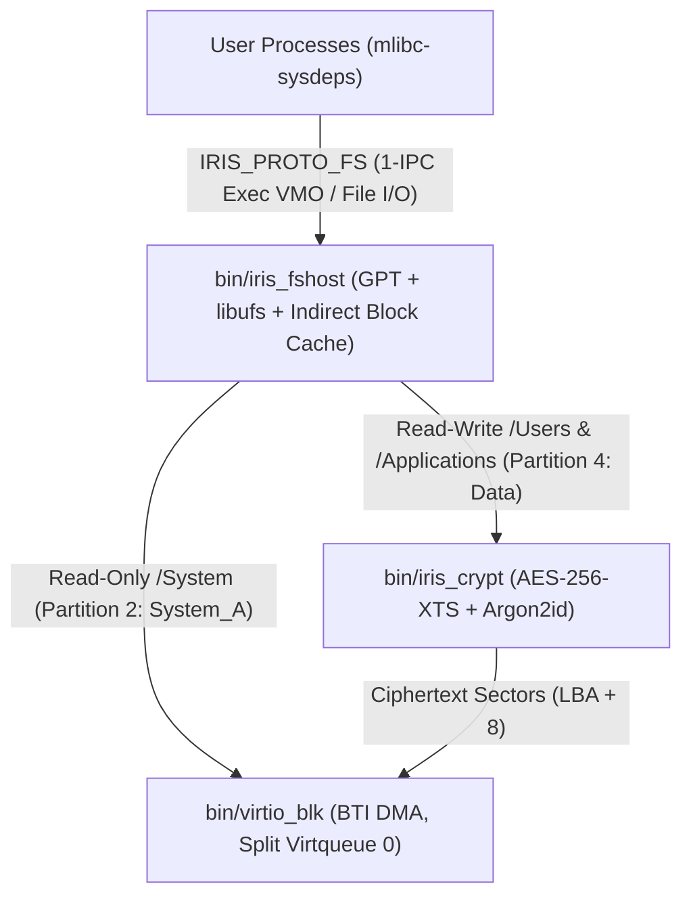

# Storage Architecture, Block Encryption (`iris_crypt`) & VFS (`iris_fshost`)

## 1. Ring 3 Storage Pipeline
All storage drivers, cryptographic transforms, and filesystem parsers run in unprivileged user space (Ring 3 / EL0) over `iris_msg_hdr_t` IPC channels:

---

## 2. 128 MB 4-Partition GPT Layout (`disk_<arch>.raw`)

| Part # | Label | LBA Range (`512B` sectors) | Size | Format | Encryption | Mount / Role |
| :---: | :--- | :--- | :---: | :--- | :--- | :--- |
| `1` | `ESP` | `2048 .. 67583` (`65,536`) | `32 MB` | FAT32 | Unencrypted | UEFI Gigaboot + `iris_a.zbi` / `iris_b.zbi` |
| `2` | `System_A` | `67584 .. 133119` (`65,536`) | `32 MB` | UFS2 | Unencrypted (RO) | Active immutable `/System` (`Priority=15, Tries=7, Successful=1`) |
| `3` | `System_B` | `133120 .. 198655` (`65,536`) | `32 MB` | UFS2 | Unencrypted (RO) | Inactive A/B update slot (`Priority=1, Tries=0, Successful=0`) |
| `4` | `Data` | `198656 .. 260095` (`61,440`) | `30 MB` | UFS2 | **AES-256-XTS** | Read-Write `/Users` & `/Applications` (`61,432` usable sectors) |

---

## 3. Block-Level Encryption Proxy (`servers/iris_crypt`)
[`bin/iris_crypt`](../servers/iris_crypt/src/main.c) is a transparent `IRIS_PROTO_DRIVER` block filter backed by **Mbed-TLS 3.6 (`libmbedcrypto.a`)** and **Argon2id**:
* **4 KB Sector 0 Metadata Header (`iris_crypt_header_t`):** Occupies physical sectors `0..7` of Partition 4 (`LBA 198656..198663`), storing magic `"IRISCRYPT"`, Argon2id cost parameters (`t_cost=3`, `m_cost=64 KiB`, `lanes=1`), 256-bit salt, wrapped 512-bit XTS master key, and SHA-256 verification tags.
* **Sector Translation & Tweak:** Logical sector $L \in [0, 61431]$ maps to physical LBA `start_lba` $+ 8 + L$. Each 512-byte sector is encrypted/decrypted via `mbedtls_aes_crypt_xts` using the 64-bit little-endian logical sector number as the 16-byte XTS data unit tweak.

---

## 4. Central VFS Router (`servers/iris_fshost`) & Caching Architecture
[`bin/iris_fshost`](../servers/iris_fshost/src/main.c) links FreeBSD's [`vendor/libufs`](../vendor/libufs/) with the IPC block adapter in [`ufs_io.c`](../servers/iris_fshost/src/ufs_io.c) (`DEV_ID_SYSTEM_A = 1`, `DEV_ID_DATA_CRYPT = 2`):
* **Strict Read-Only `/System`:** Any write, create, mkdir, or unlink targeting `/System` (or `/bin`, `/lib`) returns `IRIS_ERR_READ_ONLY` (`EROFS`).
* **1-IPC `/System` Executable VMO Cache (`IRIS_FS_OP_GET_EXEC_VMO`):** Caches executable VMOs (`zx_vmo_replace_as_executable`) for immutable `/System/Bin/*` ELF binaries by inode number. Subsequent `posix_spawn()` calls receive a duplicated VMO handle in **1 IPC round-trip** and share physical `.text`/`.rodata` pages across processes.
* **UFS2 Indirect Block Cache & 32 KB Contiguous Read Coalescing:** `handle_fs_read` caches indirect pointer blocks (`di_ib[0]`, `di_ib[1]`) in memory and coalesces up to 8 contiguous 4 KB UFS2 blocks (`32 KB` = `64` sectors) into a single `bread()` IPC transfer.
* **True Write-Through Persistence on `/Users`:** All file data (`bwrite`) and inode updates (`putinode`) on `Data` write directly through `iris_crypt -> virtio_blk`, while Cylinder Group (`cgwrite1`) and Superblock (`sbwrite`) writes execute only when block allocations change or on `sync()`.
* **A/B Boot Watchdog Confirmation (`IRIS_FS_OP_CONFIRM_BOOT`):** Updates the active GPT partition entry attributes (`boot_successful = 1`) and recomputes CRC32 checksums on both primary and backup GPT headers once user-space initialization succeeds.
